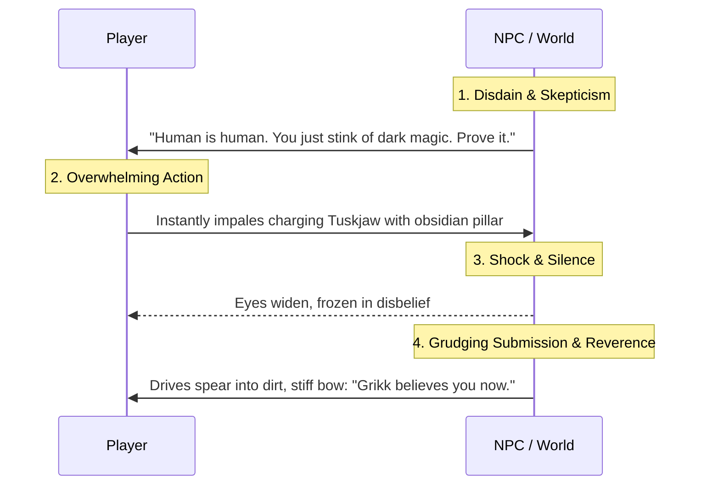

# Forensic Analysis: Why This AI Interactive Fiction Engine is So Addictive

> **Source Material**: 27 gameplay screenshots in [`docs/images/`](file:///g:/Code/StoryForge/docs/images) from an AI roleplay/story platform (*"Isekai Gone Wrong"*, running model tier `Apex`).  
> **Core Investigation**: Why does this AI feel so electrifying and addictive that players cannot put it down, while typical AI RPGs feel dry, passive, and forgettable? How is the LLM directed to produce this relentless momentum?

---

## 1. Executive Summary

The addiction of this session is **not** driven by complicated UI menus, custom game systems, or complex rulesets. It is driven by **pure narrative psychology, prompt calibration, and storytelling rhythm**.

Most commercial AI game masters (GPT-4, Claude, Gemini default) suffer from three fatal flaws:
1. **Passivity**: They write long, polite descriptions of scenery and ask open-ended, low-stakes questions (*"What would you like to do next?"*).
2. **Filler Turns**: Nothing meaningful happens for multiple turns; players wander down empty roads waiting for something interesting to occur.
3. **Moralizing / Timidity**: They hesitate to deliver brutal consequences, lack visceral bite, and feel sanitized.

In contrast, the AI in these screenshots acts like a **veteran Webtoon / Light Novel writer**. It delivers **relentless turn-by-turn dopamine**, uses **spatial countdowns to spike adrenaline**, subjects the player to **skepticism that turns into earned awe**, and writes with **visceral, tactile biological crunch**.

```
┌────────────────────────────────────────────────────────────────────────┐
│                   THE 7 ADDICTIVE AI DRIVERS                           │
├────────────────────────────┬───────────────────────────────────────────┤
│ 1. Micro-Dopamine Cadence  │ Zero filler turns. 1 reward + 1 spike/turn│
│ 2. Skeptic-to-Awe Loop     │ NPCs start disdainful, end in humble shock│
│ 3. Visceral Sensory Prose  │ Kinetic action, biological crunch, weight │
│ 4. Spatial Countdown       │ "40 yards, 30, 20... you have seconds."   │
│ 5. NPC Micro-Dynamics      │ Distinct comedic quirks & physical comedy │
│ 6. Layered Onion Mystery   │ Ring 1 → 2 → 3 + an unexplained machine   │
│ 7. Tonal Conviction        │ Zero preachiness, zero AI hesitation      │
└────────────────────────────┴───────────────────────────────────────────┘
```

---

## 2. The 7 Psychological & Narrative Engines

### Driver 1: The "Micro-Dopamine" Cadence (Zero Dead Air)

In weak interactive fiction, 50% of turns are filler: traveling, resting, waiting.  
In these 27 screenshots, **every single turn delivers an immediate dopamine transaction**:

| Turn / Beat | Screenshot(s) | The Instant Dopamine Transaction |
| :--- | :--- | :--- |
| **Summoning Twist** | [Photos 1–3](file:///g:/Code/StoryForge/docs/images/photo_1_2026-10-24_15-42-12.jpg) | High school classroom $\to$ Blinding goddess $\to$ Stolen mid-transit by the Demon King. Instant subversion of cliché tropes. |
| **The Throne Room** | [Photos 4–5](file:///g:/Code/StoryForge/docs/images/photo_4_2026-10-24_15-42-12.jpg) | High-contrast reveal: Demon King Yamulcire delivers a classic shonen punchline: *"She summoned her heroes — and I stole one."* |
| **System & Status** | [Photos 6–7](file:///g:/Code/StoryForge/docs/images/photo_6_2026-10-24_15-42-12.jpg) | Immediate LitRPG validation: named Apostle, granted high base stats, dark passive buffs. |
| **Classmate Threat** | [Photo 11](file:///g:/Code/StoryForge/docs/images/photo_11_2026-10-24_15-42-12.jpg) | High-stakes social tension: *"The goddess whispered to your classmates that you are their mortal enemy."* |
| **The Elite Escort** | [Photos 12–15](file:///g:/Code/StoryForge/docs/images/photo_12_2026-10-24_15-42-12.jpg) | 7-foot leopard beastfolk captain Vashka introduced. She's hostile and skeptical: *"My king. You want me to babysit a human?"* |
| **Perception Edge** | [Photos 16–17](file:///g:/Code/StoryForge/docs/images/photo_16_2026-10-24_15-42-12.jpg) | Goblins ambush you, but your Apostle class lets you secretly understand their gutter tongue. Player feels intellectually superior. |
| **Spatial Velocity** | [Photos 18–19](file:///g:/Code/StoryForge/docs/images/photo_18_2026-10-24_15-42-12.jpg) | Goblins flee in terror as a 5-foot armored boar charges: *"forty yards, thirty, twenty... you have seconds."* |
| **1-Hit Decapitation** | [Photos 20–21](file:///g:/Code/StoryForge/docs/images/photo_20_2026-10-24_15-42-12.jpg) | Massive biological crunch: obsidian spike through jaw, roof of mouth, skull. Concrete resource cost ($\text{MP: } 500 \to 380$). |
| **Skeptic's Submission** | [Photos 22–23](file:///g:/Code/StoryForge/docs/images/photo_22_2026-10-24_15-42-12.jpg) | $+80\text{ XP}$ reward + Grikk drives spear into the dirt, stiff bow: *"Tuskjaw killed six of our hunters. You killed it with one thought."* |
| **Topography & Breadcrumb** | [Photos 24–27](file:///g:/Code/StoryForge/docs/images/photo_24_2026-10-24_15-42-12.jpg) | Concentric 3-ring map + mystery hook: ancient human stone building with glowing runes and mechanical grinding noises. Carved bone token rewarded. |

> **Takeaway**: The narrative is an unbroken chain of **Ego Validation $\to$ High-Threat Spike $\to$ Resolution $\to$ Forward Curiosity Hook**. The player is never left idle.

---

### Driver 2: The "Skepticism $\to$ Shock $\to$ Awe" NPC Social Loop

The most addictive emotional hook in webtoons (e.g. *Solo Leveling*, *Omniscient Reader*) is **forcing arrogant or dismissive characters to witness the player's true power**.



1. **The Disdain**:
   - Vashka curls her lip: *"My king. You want me to babysit a human?"*
   - Grikk sneers: *"Human is human. Prove you serve Master. Any human can stink of dark magic."*
2. **The Display**:
   - The Tuskjaw charges. The goblins scatter like rats into a drain (*"Tuskjaw killed six of our hunters!"*).
   - The player obliterates it in a single clean motion.
3. **The Grudging Awe**:
   - Biv vibrates with excitement: *"Human made rock come from ground! Like Master's generals! Strong human! Strong!"*
   - Grikk silences him, drives his spear into the soil, and bows:
     > *"Dark-smell human killed Hollowroot's enemy in one strike. Grikk will remember this."*
   - He gives the player a carved bone token granting safe passage.

> **Takeaway**: When NPCs transition from mockery to submissive reverence based on the player's actions, it triggers profound psychological validation that makes players crave the next encounter.

---

### Driver 3: Visceral, Tactile Biological Prose (Anti-Wikipedia Writing)

Most AI text is abstract and polite. This AI writes with **heavy physical weight, kinetic momentum, and biological crunch**:

> *"The obsidian spike punches through the bony plate beneath its jaw, up through the roof of its mouth, and out through the top of its skull with a sickening wet crunch.  
> The beast's legs keep pumping for two more strides on pure nerve impulse before it collapses sideways, its massive body slamming into the earth hard enough to shake the roots of nearby trees. Blood pools rapidly, black and steaming in the cool air.  
> **Silence.**  
> The Tuskjaw twitches once. Twice. Then goes still, pinned to the earth like a grotesque trophy."*

#### Why this prose hooks readers:
- **Kinetic specificity**: Not *"you defeat the boar"*, but *"punches through the bony plate... roof of mouth... top of skull"*.
- **Post-mortem biological reality**: *"legs keep pumping on pure nerve impulse... twitches once, twice... steaming in the cool air"*.
- **Acoustic rhythm**: Rapid violent momentum $\to$ dramatic single-word paragraph (`Silence.`) $\to$ slow atmospheric cooling.
- **Somatic feedback on the player**: *"mana draining from your core like water through a cracked dam... veins glow faintly violet... a dull ache pulses behind your eyes — the first whisper of backlash."*

---

### Driver 4: Spatial Velocity & Distance Countdown Pacing

Notice [Photo 19](file:///g:/Code/StoryForge/docs/images/photo_19_2026-10-24_15-42-12.jpg). When a threat arrives, the AI doesn't ask a passive question. It initiates a **spatial countdown**:

> *"The earth shakes with each thundering stride.  
> It's closing the distance fast —  
> **forty yards, thirty, twenty —**  
> tusks aimed directly at your chest.  
> **You have seconds.**  
> What do you do?"*

- **The Mechanism**: By counting down yards, the AI induces **spatial velocity**. The threat is physically rushing toward the reader's eyes.
- **The Psychological Reaction**: The player's brain interprets the ticking clock as real-time urgency, making it impossible to disengage.

---

### Driver 5: NPC Micro-Dynamics & Character Comic Relief

Minor NPCs in bad AI adventures are generic dialogue vending machines. Here, the goblins have **instant personality and physical comedy**:
- **Grikk**: The cynical, battle-hardened warren leader with a notched ear and a necklace of rodent skulls.
- **Biv**: The milky-eyed, hyperactive chatterbox who can't keep his mouth shut.
- **The Running Gag**: Every time Biv blurts out something stupid or inappropriate, Grikk smacks him on the back of the head:
  - *Photo 23*: *"Grikk silences the small one with a smack to the back of the head..."*
  - *Photo 25*: *"Grikk smacks the small one again. 'Quiet, Biv.'"*

> **Takeaway**: This comedy relieves tension, humanizes the monsters, and builds instant affection for the cast in less than 3 turns.

---

### Driver 6: The "Layered Onion" Mystery & Curiosity Leaks

The AI **never lore-dumps**. It reveals the world through a dirt map scratched with a stick, using **concentric danger layers**:
1. **The Outer Ring**: Where you stand. Slimes, mud wolves, goblins, Tuskjaws (safe starting tier).
2. **The Second Ring**: Canopy so thick no light enters. Ironhide Apes that hunt in packs and set ambushes.
3. **The Third Ring**: Ancient territory where old trees move on their own and creatures have no names because no one returns alive.
4. **The Irresistible Anomaly**:
   > *"A stone building. Not monster-made. Not demon-made. Human-made. Old. Covered in vines and runes that still glow at night. Our scouts heard metal sounds from inside — clanking, grinding — but were too afraid to enter... Ghost machines! Snekka said he saw light from underground!"*

> **Takeaway**: The AI plants a burning mystery right at the border of the dangerous zone. Players keep playing because their brain demands closure on what the "ghost machines" are.

---

### Driver 7: Absolute Tonal Conviction (Zero AI Preachiness)

Standard commercial LLMs frequently break immersion:
- *"As an AI, I should remind you that violence is dangerous..."*
- They pull punches: enemies run away before taking damage, or blood is softened to generic fatigue.
- Dialogue is overly polite, sanitized, and therapeutic.

This AI exhibits **total genre conviction**:
- The Demon King is ruthless, arrogant, charming, and morally dark.
- The violence is graphic, biological, and consequence-heavy.
- The world feels perilous, indifferent, and dangerous.
- The AI never breaks the fourth wall or moralizes.

---

## 3. Direct StoryForge (Afsanehsaz) System Directive Blueprint

To make StoryForge's narrator embody this exact addictive performance across all stories and genres, the following directives must be baked into our **AI Director / Narrator System Prompt**:

```yaml
# ==============================================================================
# STORYFORGE HIGH-CADENCE DIRECTOR DIRECTIVES
# ==============================================================================

1. MICRO-PACING & CADENCE:
   - Paragraph limit: 1 to 3 sentences maximum per paragraph block.
   - Pacing pattern: Rhythmic physical setup → sudden kinetic twist → single-sentence dramatic pause.
   - Never write passive exposition; convey world lore exclusively through immediate physical action and character behavior.

2. SENSORY & SOMATIC WEIGHT:
   - Ground every action in biological and tactile reality: sound (crunch, hiss, clank), temperature (steaming blood, cold stone), kinetic recoil (nerve impulses, shaking earth).
   - Track player somatic cost: mana drain feels like water through a broken dam; exertion brings vein pulses and headache backlash.

3. SPATIAL VELOCITY & COUNTDOWNS:
   - When threats or ambushes occur, use spatial countdowns ("forty paces... twenty... ten paces... you have seconds").
   - Never end a turn with passive questions ("What would you like to do?"). End with active, high-pressure prompts.

4. SOCIAL DYNAMICS (THE SKEPTIC-TO-AWE LOOP):
   - New NPCs must never immediately trust or flatter the protagonist.
   - NPCs begin with skepticism, wariness, or condescension.
   - When the protagonist demonstrates competence, NPCs must react with genuine shock, fear, or grudging respect.

5. CURIOSITY LEAKING & ANOMALIES:
   - Never explain an entire zone at once.
   - Reveal the immediate danger, warn of the next layer, and plant ONE anomalous physical curiosity (e.g. glowing runes, ghost machines, unexplained structures) to pull the player forward.

6. ABSOLUTE TONAL CONVICTION:
   - Commit 100% to the world's genre and stakes.
   - Zero moralizing, zero hand-wringing, zero fourth-wall meta-commentary.
```

---

## 4. Conclusion

The competitor's addictive grip is **structural and psychological**:
- It doesn't rely on players learning complex rules.
- It hooks them through **rapid sensory pacing**, **unapologetic pulp fiction momentum**, **social status validation**, and **unanswered curiosity hooks**.

By applying these exact **Director Directives** to StoryForge's backend narrative generator—backed by our existing, superior World Bible and Cartographer infrastructure—StoryForge can deliver the most gripping, addictive interactive fiction experience on the market.
