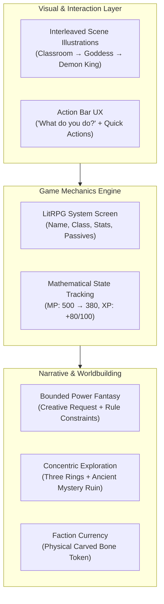

# Competitive UX & Architecture Analysis: Generative Webtoon & LitRPG Adventure

> **Source Analysis**: 27 mobile gameplay screenshots located in [`docs/images/`](file:///g:/Code/StoryForge/docs/images) from a high-tier interactive fiction / AI roleplay platform (Session: *"Isekai Gone Wrong"*, running model tier `Apex`).  
> **Subject**: Reverse-engineering the user engagement hooks, visual pacing, LitRPG progression loops, and identifying actionable architectural upgrades for **StoryForge (Afsanehsaz)**.

---

## 1. Executive Summary

The analyzed session demonstrates a hybrid form of **Generative Webtoon & Monospaced LitRPG Text-Adventure**. Unlike traditional AI chatbots that display a single static avatar and walls of unillustrated dialogue, this interface creates an addictive reading experience by combining:

1. **Episodic Visual Pacing**: Sequential, scene-specific anime/manhwa illustrations embedded directly into the text stream like manga panels.
2. **Deterministic-Style LitRPG HUDs**: Explicit, in-world status screens (`LVL`, `HP`, `MP`, `XP`, `Passive Buffs`) with mathematical resource tracking ($500 - 120 = 380\text{ MP}$).
3. **High-Tension Decision Forks**: Action prompts that pose immediate physical urgency (*"40 yards, 30, 20... you have seconds. What do you do?"*).
4. **Concentric World Geography ("The Three Rings")**: Clear, mental progression tiers from low-risk wilderness to deadly eldritch heartlands.
5. **Bounded Creative Agency**: Honoring wild player requests (*"power to make imagination real"*) while imposing strict in-universe rules (*"Level 1: simple shapes only; overdraft causes physical backlash"*).

---

## 2. Turn-by-Turn Case Study (From the Screenshots)

| Beat | Screenshot(s) | Narrative Event | UX & Mechanical Hook |
| :--- | :--- | :--- | :--- |
| **1. The Inciting Summons** | [Photo 1](file:///g:/Code/StoryForge/docs/images/photo_1_2026-10-24_15-42-12.jpg) – [Photo 3](file:///g:/Code/StoryForge/docs/images/photo_3_2026-10-24_15-42-12.jpg) | Classroom setting $\to$ Blinding goddess summons class $\to$ Souls pulled through dimensional light. | **Visual Rhythm**: High school establishing shot followed immediately by high-fantasy goddess illustration. |
| **2. The Demon King's Heist** | [Photo 4](file:///g:/Code/StoryForge/docs/images/photo_4_2026-10-24_15-42-12.jpg) – [Photo 5](file:///g:/Code/StoryForge/docs/images/photo_5_2026-10-24_15-42-12.jpg) | Player awakens on black marble before Demon King Yamulcire, who stole one hero from the goddess. | **Micro-Expression Shots**: Mid-range throne reveal followed by a tight facial portrait showing Yamulcire's golden slit eyes. |
| **3. The LitRPG System Invocation** | [Photo 6](file:///g:/Code/StoryForge/docs/images/photo_6_2026-10-24_15-42-12.jpg) – [Photo 7](file:///g:/Code/StoryForge/docs/images/photo_7_2026-10-24_15-42-12.jpg) | Player commands: *"Status window, I want the power to make my imagination real"*. | **Instant Diegetic Screen**: AI generates a monospaced Status Window with Stats, Class, Level, HP/MP pools, and Passives. |
| **4. Power Negotiation & Backlash Rules** | [Photo 8](file:///g:/Code/StoryForge/docs/images/photo_8_2026-10-24_15-42-12.jpg) – [Photo 10](file:///g:/Code/StoryForge/docs/images/photo_10_2026-10-24_15-42-12.jpg) | Yamulcire grants `Unique Skill: Phantasm Forge` but sets hard limits (MP costs, Level 1 limits, overdraft recoil). | **Bounded Agency**: Player gets their exact wish, but with compelling tactical constraints and failure consequences. |
| **5. Escort to the Frontier** | [Photo 11](file:///g:/Code/StoryForge/docs/images/photo_11_2026-10-24_15-42-12.jpg) – [Photo 15](file:///g:/Code/StoryForge/docs/images/photo_15_2026-10-24_15-42-12.jpg) | Leopard beastfolk captain *Vashka* escorts player across obsidian plains to the edge of *Monster Glade*. | **Companion Introduction**: New distinct NPC with clear personality, hostility, and departure boundary. |
| **6. The First Encounter (Goblins)** | [Photo 16](file:///g:/Code/StoryForge/docs/images/photo_16_2026-10-24_15-42-12.jpg) – [Photo 17](file:///g:/Code/StoryForge/docs/images/photo_17_2026-10-24_15-42-12.jpg) | Three goblins corner the player; player understands their speech due to class buff; goblins smell the Demon King's mark. | **Class Perk Payoff**: The passive buff granted in Beat 3 immediately creates a unique diplomatic interaction. |
| **7. Sudden Ambush (Tuskjaw)** | [Photo 18](file:///g:/Code/StoryForge/docs/images/photo_18_2026-10-24_15-42-12.jpg) – [Photo 19](file:///g:/Code/StoryForge/docs/images/photo_19_2026-10-24_15-42-12.jpg) | A giant armored boar charges. Goblins flee. Distance closes from 40 yards to 20 yards. | **Pacing Hook**: Sensory cues (smell of rotting meat, cloven hooves shaking earth) ending in *"What do you imagine?"* |
| **8. Mechanical Combat & Mana Burn** | [Photo 20](file:///g:/Code/StoryForge/docs/images/photo_20_2026-10-24_15-42-12.jpg) – [Photo 21](file:///g:/Code/StoryForge/docs/images/photo_21_2026-10-24_15-42-12.jpg) | Player manifests an obsidian spike. Tuskjaw impales itself. Player suffers backlash headache and checks mana. | **Transparent Math**: $\text{MP: } 500 - 120 = 380 / 500$. Cost is calculated and registered in the narrative. |
| **9. XP Reward & Leveling Progress** | [Photo 22](file:///g:/Code/StoryForge/docs/images/photo_22_2026-10-24_15-42-12.jpg) | *"Plated Tuskjaw defeated. XP gained: 80."* Player feels the energy settle into muscles (80/100 to LVL 2). | **Dopamine Hit**: Immediate numerical validation of victory, leaving the player eager for 20 more XP. |
| **10. Topographical Lore: The Three Rings** | [Photo 23](file:///g:/Code/StoryForge/docs/images/photo_23_2026-10-24_15-42-12.jpg) – [Photo 25](file:///g:/Code/StoryForge/docs/images/photo_25_2026-10-24_15-42-12.jpg) | Grikk draws a map in the dirt: Outer Ring (slimes/boars) $\to$ Second Ring (Ironhide Apes) $\to$ Third Ring (unnamed horrors). | **Spatial Hierarchy**: Clean mental scaffolding for exploration and danger progression. |
| **11. Quest Anchor & Faction Token** | [Photo 26](file:///g:/Code/StoryForge/docs/images/photo_26_2026-10-24_15-42-12.jpg) – [Photo 27](file:///g:/Code/StoryForge/docs/images/photo_27_2026-10-24_15-42-12.jpg) | Grikk mentions an ancient human stone building with glowing runes and clanking gears; gives a carved bone token. | **Physical Inventory Item**: Safe conduct token for *Hollowroot* clan, setting up rivalries with *Blackmoss* and *Redclaw*. |

---

## 3. The 5 Core Pillars of Engagement

### 1. Interleaved Webtoon Visual Storytelling
Traditional CYOA apps either have zero images or one static hero header. This app treats the scrollback as a **dynamic manga reader**:
- Visual frequency: ~1 full-width illustration every 200–350 words of prose.
- Image role: Not generic background decoration, but visual punctuation (e.g. the exact expression of the Demon King as his attitude softens from condescension to intrigued respect).

### 2. Concrete LitRPG Status Screens & Transparent Math
Readers love visible numbers. When the player summons a status window:
- It renders in a dedicated monospaced format.
- Resource deductions are not abstract; they have exact numerical costs ($120\text{ MP}$) that leave the remaining gauge visible ($380/500$).
- Experience rewards are explicit ($+80\text{ XP}$ against a $100\text{ XP}$ threshold), setting up an immediate craving for the next encounter.

### 3. High-Urgency Action Prompts ("What do you do?")
Every narrative turn concludes with a sharp, active choice boundary:
- Instead of open-ended conversational prompts (*"What would you like to say?"*), it uses action verbs: *"What do you imagine?"*, *"What do you do?"*.
- Imminent physical peril forces immediate decision-making (*"twenty yards, fifteen, the stench hits you... you have seconds"*).

### 4. Concentric Zone Architecture (The Dirt Map)
The goblin NPC drawing concentric circles in the dirt establishes an instant, intuitive mental model:
- **Ring 1 (Outer)**: Goblins, beasts, manageable for solo Level 1.
- **Ring 2 (Mid)**: Pack-hunting ambushers (Ironhide Apes, Thornback Serpents).
- **Ring 3 (Core)**: Eldritch territory where living trees move and no survivors return.
- **Dungeon Hook**: An ancient mechanical human ruin at the transition border between Ring 2 and Ring 3.

### 5. Tangible Social Currency (Faction Tokens)
The player isn't just told *"the goblins like you"*; they receive a physical inventory item:
- A carved bone token.
- Concrete social rules: grants immunity among *Hollowroot* goblins, but warns that *Blackmoss* and *Redclaw* warrens will attack on sight.

---

## 4. Comprehensive Comparison: StoryForge vs. The Competitor

| Feature / Domain | Competitor App (Screenshots) | StoryForge (Afsanehsaz Current) | Gap & Opportunity |
| :--- | :--- | :--- | :--- |
| **Visual Presentation** | Scene illustrations interleaved inline into the reading stream every few paragraphs. | Parchment-style Cartographer canvas + character portrait cards; text flow is mostly unillustrated. | **High Opportunity**: Introduce an optional "Webtoon / Visual Beat" mode that generates or attaches inline scene artwork. |
| **RPG State Display** | Monospaced LitRPG System Window directly in the message stream; explicit math ($120\text{ MP}$, $+80\text{ XP}$). | Rich backend RPG schema (attributes, conditions, inventory, dice checks), but historically tucked into drawer modals. | **High Opportunity**: Bring floating resource chips (`-120 MP`, `+80 XP`) and inline System Cards into the narrative feed. |
| **World Consistency** | Purely emergent / hallucinated on the fly by the LLM prompt. | **Engine-authoritative World Bible**: 100+ locations, lore laws, NPC relationships, threat clocks, and deterministic maps. | **StoryForge Advantage**: The competitor will eventually suffer from amnesia and continuity drift. StoryForge has the deep backend to maintain long-form canon. |
| **Cartography & Geography** | Verbal description only (e.g. NPC scratches a circle in the dirt). | **Hardware-accelerated PixiJS map** with mountains, rivers, biomes, settlements, and trade routes. | **StoryForge Advantage**: We can visually reflect the "rings" and landmarks directly on the world map! |
| **Player Action Bar** | Action-oriented placeholder (`"What do you do?"`) with `*` (format), `/` (skills), and TTS audio. | Clean text input with suggestion chips. | **Quick Win**: Add action-oriented prompts, slash commands for skills, and direct neural voice narration. |

---

## 5. Architectural Implementation Roadmap for StoryForge

### Phase 1: In-Stream LitRPG "System Window" & Resource Floaters
1. **System Card Renderer**:
   - Create a specialized UI component (`LitRpgStatusCard.tsx`) rendered inline whenever a character invokes their status or experiences a level/state change.
   - Display animated progress bars for HP, MP/Stamina, and XP ($0/100$).
2. **Floating Resource Feedback**:
   - When an action consumes resources (e.g. casting a spell or suffering physical backlash), display floating stat delta pills:
     $$\textcolor{#f43f5e}{-120\text{ MP}} \quad \textcolor{#eab308}{+80\text{ XP}} \quad \textcolor{#38bdf8}{[\text{Unique Skill: Active}]}$$

### Phase 2: Episodic Scene Illustration Pipeline ("Webtoon Mode")
1. **Dramatic Beat Triggers**:
   - Identify pivotal story beats:
     - Entering a major new location (e.g. Black Castle throne room).
     - First encounter with an elite boss or legendary NPC.
     - Major plot twists or divine summoning.
2. **Inline Panel Card**:
   - Embed high-resolution generated illustrations between narrative paragraph blocks with edge-to-edge mobile formatting and zoom-inspect overlays.

### Phase 3: Concentric Danger Rings on Cartographer Canvas
1. **Zoned Region Overlays**:
   - Utilize our PixiJS cartography engine to render subtle concentric danger rings or frontier boundaries around dangerous biomes (e.g. *Monster Glade Ring 1 / 2 / 3*).
   - Display recommended Level and Danger Rating (1–5) on regional waypoints.

### Phase 4: Action Bar & Command Upgrades
1. **Action-First Prompting**:
   - Dynamic contextual placeholder: *"What do you do?"*, *"What do you imagine?"*, *"How do you defend?"*.
2. **Quick-Tool Toolbar**:
   - `*` : Quick action formatting (wrapping in italics/asterisks).
   - `/` : Slash command palette (`/status`, `/inventory`, `/cast <skill>`, `/roll`).
   - `🔊` : One-tap neural narration for the current beat using our streaming audio engine.

---

## 6. Conclusion
The competitor's viral appeal comes from **immediacy, visible progression, and visual cadence**:
- Players never read more than 3 paragraphs without an image, a stat change, or an urgent life-or-death choice.
- By marrying this **high-cadence visual/LitRPG presentation** with **StoryForge's deterministic World Bible and Cartographer engine**, StoryForge can offer both the surface thrills of an addictive manhwa game and the profound depth of an immutable living world.
