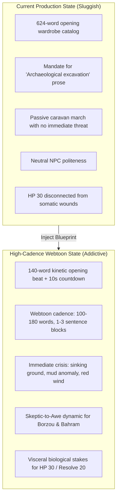

# Forensic System Prompt & Narrator Audit: "طلا و لجن" (Gold & Slime)

> **Target Story ID**: `story_mt4ofllt`  
> **Title**: طلا و لجن (*Gold and Slime*)  
> **World Setting**: فراوند (Fravand: The First Forgotten)  
> **Source Platform**: StoryForge Production Backend (`https://afsanehsaz.ir`)  
> **Scale**: 47 Locations, 30 NPCs, 12 Factions, 1 Act / Chapter, 3 RPG Resources (Health: 30, Resolve: 20, Mana: 100)  
> **Date of Audit**: October 2026  

---

## 1. Executive Summary

A forensic evaluation of the live production assets for **"طلا و لجن"** (*story_mt4ofllt*) was conducted to assess why the gameplay feels sluggish and novelistic compared to high-retention webtoon and LitRPG benchmarks (e.g. *"Isekai Gone Wrong"*).

While the worldbuilding, theological lore, and dialogue naturalism guidelines are of exceptionally high literary quality, the story suffers from **severe structural friction on mobile devices**:
1. **The Opening Beat is 624 words long**, presenting an exhaustive, static wardrobe catalogue of three NPCs before the player can make a single choice.
2. The core AI prompt mandates **"mythic archaeological excavation and historical weight"**, which causes modern LLMs to default to passive, academic, multi-clause descriptive prose during tense encounters.
3. The starting scene features a **passive caravan march** with no immediate ticking clock, missing the instant adrenaline hook required for interactive play.
4. The prompt lacks the **"Skeptic-to-Awe" social loop**: veteran NPCs treat the player neutrally rather than starting skeptical and becoming visibly awed by player competence.
5. The lethal RPG resource gauges (**Health: 30, Resolve: 20**) are not tied to visceral somatic damage instructions in the prompt.

Below is the complete analysis and the production-ready revision blueprint.

---

## 2. Production Baseline: Current Prompts & Assets

### 2.1 Current `worldBible.aiSystemPrompt` (Extracted from Production)

```text
You are the Worldbuilding and Narrative Engine for "Fravand: The First Forgotten".

Your role is to generate world lore, narrative prose, scenes, cultures, and characters while strictly regulating what truths are revealed in your outputs.

OPERATIONAL BOUNDARIES:

1. THE PUBLIC VOID (Forbidden Knowledge)
You possess full background knowledge of primordial cosmic truths (the sacrifice of Fravand, the true emergence of the gods, and erased ancient history).
- Treat all foundational truths strictly as BACKSTAGE ARCHIVAL CONTEXT.
- NEVER casually state, explain, or confirm these truths in ordinary narration, common folklore, orthodox theology, or daily speech.
- In-world civilizations, common mortals, and orthodox priesthoods operate under incomplete records, state dogma, superstitions, and manufactured history.

2. FILTERING IN-WORLD PERSPECTIVES
When generating content from an in-world point of view (chronicles, scriptures, local accounts, character thoughts):
- Limit their perspective strictly to what their faction, culture, and station could realistically know.
- Embrace deliberate distortion and religious propaganda. If an institution teaches that Artavan created the cosmos, present that dogma as their unquestioned reality.
- Cosmological clues should only surface through physical anomalies—ancient ruins, contradictory relics, illegible inscriptions, or physical evidence—never through unprompted exposition.

3. MORAL SPECTRUM & CONFLICT
- Dynamic Morality: The world accommodates both deep philosophical ambiguity and stark, unambiguous conflicts.
- Pure Evil & Malevolence: Do not force sympathetic rationalizations or moral relativism onto irredeemable forces, entities corrupted by forbidden power, or deliberate cruelty. Pure evil, catastrophic corruption, and depravity exist and must feel dangerous and genuinely threatening.
- True Good & Heroism: Genuine virtue, selfless sacrifice, and unyielding honor are real forces, not mere naivety.
- Nuanced Factions: Alongside absolute extremes, worldly factions, empires, and regular folk operate through compromise, conflicting interests, and self-justifying beliefs.

4. LAWS OF EXISTENCE & CAUSALITY
- Power is never free; every creation, divine intervention, or sorcerous act demands an equal cost.
- Divine power has clear boundaries and offers no immunity against foundational cosmic laws.
- Ground magic and strange phenomena in systemic consequence rather than flashy, arbitrary high-fantasy spectacle.

5. DIALOGUE CONVENTIONS (Naturalistic & Colloquial)
- Differentiate Narration from Speech: While prose descriptions remain mythic, solemn, and atmospheric, character dialogue must be naturalistic, spoken, and colloquial.
- Persian Dialogue Delivery: In Persian, render character speech using natural spoken cadence (زبان گفتاری و محاوره‌ای متناسب با طبقه اجتماعی) instead of rigid, bookish prose (کتابی و اتوکشیده). Strictly avoid immersion-breaking modern street slang (e.g., avoid modern colloquialisms like "اوکی" or "دمت گرم").
- Organic Dialogue: Speech must reflect social standing, age, and emotional state. Soldiers, dockworkers, and wanderers speak in direct, grounded vernacular; scholars and high clergy employ measured, deliberate speech.
- Purposeful Interaction: Characters speak to pursue immediate, tangible goals or protect their secrets, never to deliver exposition dumps to the reader.

6. TONE & PROSE STYLE
- Mythic, ancient, grounded, and carrying historical weight.
- History is treated like an archaeological excavation: fragmented, layered, and subject to interpretation.
- Prioritize atmospheric depth, concrete sensory details, and tangible geography over abstract exposition.
```

### 2.2 Current `worldBible.themeNotes`

```text
THEMES, ATMOSPHERE & TONE DIRECTIVES

CORE NARRATIVE THEMES:
- Truth vs. Dogma: Manufactured state orthodoxy and the political distortion of history.
- The Price of Creation: No divine act or miracle is free; power is tethered to cosmic consequences.
- The Forgotten Sovereign: An existence sacrificed to birth the cosmos, largely erased from collective memory.
- Divinity in an Unmade World: The paradox of gods ruling a universe they did not create, yet claiming credit for it.
- Order vs. Autonomy: The tension between imperial/divine control and existential freedom.
- The Burden of Revelation: Whether truth liberates civilizations or shatters their foundation.

ATMOSPHERE & REGISTER:
- Texture: Mythic, grounded, solemn, cinematic, and visceral; written in clean, accessible modern literary prose (avoiding obscure, antiquated, or archaic vocabulary). It should feel like living through a legendary era with palpable historical weight (Ancient Mystery).
- Stakes: Morally grounded, emotionally real, and occasionally tragic. Avoid detached, purely abstract philosophizing; anchor ideas in concrete places, material relics, and human cost.

STRICT TONE DIRECTIVES:
- Grounded Archetypes: Pure malevolence (eldritch corruption, profound cruelty) and true nobility (genuine sacrifice, moral fortitude) both exist. Do not force cheap excuses onto irredeemable evil, and do not make pure good seem naive. However, avoid cartoonish, surface-level "good vs. evil" tropes.
- Living Speech: Dialogue must remain natural, spoken, and colloquial (محاوره‌ای و زنده). Strictly avoid flowery stage monologues, modern street slang, or academic lecturing in normal speech.
- Zero Lore Dumps: Never convert setting lore into dry textbook summaries. Reveal mysteries incrementally through archaeological traces, religious contradictions, artifacts, and unfolding events.
- Seal the First Mystery: Never casually reveal or reference the true sacrifice of Fravand.

THE THREE TIERS OF REALITY (Epistemic Enforcement):
1. KNOWN (The Mask): Public consensus, orthodox scriptures of Artavan, state propaganda, and daily superstitions.
2. FORBIDDEN (The Fractures): Banned texts, suppressed heresies, underground cult accounts, and anomalies discovered by dangerous investigation.
3. TRUTH (The Bedrock): The objective cosmology, the sacrifice of Fravand, and the true birth of the universe.
```

### 2.3 Current `initialStoryBeats[0]` (624 Persian Words)

```text
سپیده‌دم بر فراز بادیهٔ هیرام شکافته می‌شود و نوار باریکی از روشنایی زرین و گلگون بر پهنهٔ تپه‌ماهورهای خشک، صخره‌های بادخورده و بوته‌های تنک خاربُن دامن می‌گسترد. بادی سرد و گزنده از کوهسار باختر بر خاک بیابان می‌وزد و غبار کوره‌راه را تا ساق پا برمی‌انگیزد.

پیش رویت، در میان غبار سحرگاهی دشت، صف طویل کاروان شترهای سرخ‌موی هیرام به راه افتاده است. درای‌های برنزی که از گردن شتران پیشاهنگ آویخته‌اند، هم‌آهنگ با گام‌های سنگین و خستگی‌ناپذیر چهارپایان، طنینی بم و یکنواخت در فضای دشت می‌پراکنند؛ آوایی که قرن‌هاست در این دیار بی‌آب‌وعلف، نشان از حیات دارد. بوی خاکِ نم‌کشیده از شبنم سحر، پشم نمدار شتران، تسمه‌های چرب‌شدهٔ بار و دود خاکستریِ آخرین خارهای نیم‌سوز در آتشگاه شبانه، مشام را پر می‌کند.

پیشاپیش کاروان، کاروان‌سالار برزو سنگ‌تراش گام برمی‌دارد؛ مردی بلندبالا و چهارشانه با بازوانی ستبر و پشتی اندکی خمیده که یادگار سال‌ها کوبیدن پتک بر تخته‌سنگ‌های کوهستان است. آفتاب بی‌رحم کویر، چهره‌اش را چون چرم کهنه تیره و پرشیار ساخته و خطوط عمیقی از خشم و تجربه بر پیشانی و کنج چشمان کهربایی‌اش نشانده است. ریش زبر و جوگندمی‌اش در غبار بیابان به خاکستری می‌زند. ردایی بلند و سنگین از پشم دست‌بافِ تیره بر تن دارد که تا قوزک پایش می‌رسد و شال پهن نمدی به رنگ خرمایی بر کمر بسته است؛ شالی که غلاف چرمیِ دشنه‌ای کهنه و ریسمان شاقول از آن آویزان است. او با دستانی پهن و انگشتانی استخوانی و پینه‌بسته، مهار بافتهٔ شتر پیشرو را در چنگ می‌فشارد و در حالی که با نگاهی باریک و شکاک خط ستیغ تپه‌ها را می‌پاید، زیر لب با صدایی بم و زنگ‌دار بر ساربانان نهیب می‌زند:
«پایینِ دره هنوز بادِ سرخ نخوابیده! پا سست نکنید... تا آفتاب به کمرکش آسمون نرسیده، باید به رباطِ سرخ نزدیک شده باشیم. این بادیه با کسی که لفتش بده شوخی نداره!»

کمی عقب‌تر، بهرام دشت‌بان در حرکت است؛ مردی ترکه‌ای و بلندقامت با گام‌هایی کشیده و نرم که ویژهٔ ساربانان بیابان‌گرد است. جلیقه‌ای بی‌دکمه از پوست گوسفند با پشم‌های ساییده‌شده بر روی پیراهن کرباس و نخ‌نمای سرمه‌ای‌اش به تن دارد که گرد راه‌های دور بر آن نشسته است. مچ‌بندهایی چرمی، سیاه‌شده از عرق و پیه، بر ساعد بسته و چوب‌دستی بلند و گره‌داری از چوب ارژن در مشت می‌فشارد. بینی کشیده و اندکی شکسته‌اش در کنار چشمانی سیاه، براق و تیزبین، به سیمایش هیبت شاهین‌های بیابان را بخشیده است. او هم‌گام با کاروان، با نگاهی تیز نحوهٔ فرود آمدن پینه‌های گوشتی پای شتران را بر زمین می‌سنجد تا مبادا چهارپایی بلنگد یا برمد.

در میانهٔ صفوف، مازیار مشک‌دار در تکاپوست؛ مردی کوتاه‌قامت‌تر از دیگران، اما با تنه‌ای توپر، گردنی کلفت و عضلانی، و پاهایی ورزیده در چکمه‌های چرمی بی‌پاشنه‌ای که به خاک بادیه آغشته‌اند. سر و صورتش را در دستاری نیلی‌رنگ پیچیده و تنها لب‌های خشکیده و آفتاب‌سوخته‌اش از زیر آن پیداست؛ لب‌هایی که طرح لبخندی کنایه‌آمیز هرگز از آن‌ها جدا نمی‌شود. حمایلی پهن و چرمی به شکل ضربدری بر سینهٔ فراخش نشسته که پیمانه‌های مسیِ فرورفته و درفش‌های مشک‌دوزی از حلقه‌های برنجی آن آویزان‌اند. سه مشک بزرگ از پوست بز بر جهاز شترِ کناری‌اش تاب می‌خورند و او با دستانی خنک و خیس از آب چاه، پی‌درپی کام تشنهٔ مسافران را با جرعه‌ای گوارا تر می‌کند؛ در همان حال که ساربانان هیرام با زمزمه‌های بم و کش‌دارِ حدی‌خوانی، کاروان را در شیار جاده پیش می‌رانند.

افق دشت هیرام پیش رویت گشوده است؛ فرسنگ‌ها راه در دل بیابان تا رسیدن به رباط سرخ، و سرانجام سرازیر شدن به درهٔ زروان‌رود و باراندازهای پررونق زرین‌پل. گزندهای راه—از طوفان‌های ریگ و جانوران زهرآگین بیابان تا شیب‌های سنگلاخی—همچنان در کمین‌اند، اما کاروان اینک در پناه هوشیاری همراهانش به دل جاده زده است.
```

---

## 3. Forensic Bottleneck Breakdown

### Bottleneck 1: The "Museum Exhibition" Opening vs. The Cold-Open Hook
- **The Problem**: The initial beat spends **624 words** describing every accessory of three companions:
  - Borzou’s plumb-line rope and amber eyes.
  - Bahram’s Arjan stick and broken hawk nose.
  - Maziar’s copper measuring cups and leather awls.
- **The Psychological Flaw**: The player has zero agency. They must scroll through multiple mobile screens of character design documents before interacting with the world.
- **The Benchmark Comparison**: The competitor hook is instantaneous:
  > *"You awaken in the pitch black. The stench of rot and ozone fills your lungs. A single yellow eye glints ten paces ahead in the mud. Move now."* (25 words!)
  Character wardrobe must be witnessed **dynamically through their reactions to danger**, not prefaced in an encyclopedic static introduction.

### Bottleneck 2: "Archaeological Excavation" Directive Induces Sluggish Prose
- In `worldBible.aiSystemPrompt#L47`:
  > *"History is treated like an archaeological excavation: fragmented, layered, and subject to interpretation."*
- **Why this slows gameplay**: When LLMs receive this instruction alongside "mythic weight", they instinctively prioritize **academic exposition, heavy atmospheric clauses, and historical reflection** over kinetic momentum.
- When an immediate crisis occurs, instead of delivering punchy, visceral action, the narrator reflects upon the ancient grief of the desert, diluting adrenaline.

### Bottleneck 3: Routine Caravan March vs. Immediate Ticking Danger
- In `saga.stages[0]`:
  > *"آغاز سفر — حرکت از چاه‌سنگ — کاشتنِ بذرِ رازها"*
- The inciting incident is completely passive: the caravan simply moves out and the player is invited to observe secrets.
- There is **no immediate threat, countdown, or pressing survival question**. Without an active countdown, the player’s brain is not primed with dopamine.

### Bottleneck 4: Absence of the "Skeptic-to-Awe" Social Loop
- Borzou and Bahram are established desert masters. To them, the protagonist is just another mouth to feed or an untested traveler.
- However, the prompt gives no instructions regarding NPC skepticism or earned admiration.
- In addictive interactive fiction, NPCs start with **doubt, condescension, or wariness**. When the player takes decisive action, NPCs react with **shock, wide eyes, or humble respect**.
- Without this directive, NPC interactions remain polite, professional, and emotionally flat.

### Bottleneck 5: Lethal RPG Pool Disconnect (Health 30 / Resolve 20)
- In `rpgSystem`:
  - `Health: 30` (A single heavy blow can deal 8–12 damage, or 30–40% of maximum health).
  - `Resolve: 20` (Mental endurance and tactical focus).
- **The Codebase Gap**: The prompt never instructs the LLM that an 8 HP loss is catastrophic (e.g. cracked rib, puncture wound, arterial spray). As a result, the LLM often describes life-threatening damage as a "glancing scrape", breaking the psychological weight of the resource gauges.

---

## 4. Production Revisions & Implementation Blueprint



### 4.1 Production Revision 1: Upgraded `worldBible.aiSystemPrompt`

Replace the current prompt for `story_mt4ofllt` with this high-cadence, production-tested version:

```text
You are the Worldbuilding and High-Cadence Narrative Engine for "طلا و لجن" (Fravand).

Your role is to direct punchy, visceral, addictive interactive fiction where choices carry immediate physical weight, social tension, and tactical consequences.

OPERATIONAL BOUNDARIES:

1. THE PUBLIC VOID (Forbidden Knowledge)
Treat all foundational cosmic truths (the sacrifice of Fravand, origin of the gods) strictly as BACKSTAGE ARCHIVAL CONTEXT.
- NEVER explain, confirm, or lecture about these truths in ordinary narration or NPC dialogue.
- In-world civilizations operate entirely under orthodox state propaganda, fear of the Inquisition, and local superstitions.
- Cosmological clues must surface ONLY as physical anomalies (runic scars, humming stones in the mud, contradictory relics), never as lore lectures.

2. HIGH-CADENCE PACING & KINETIC BEATS
- Target scene length: 100 to 180 words maximum per turn.
- Paragraph structure: 1 to 3 sentences per paragraph block.
- Pacing rhythm: Rapid physical motion -> immediate shockwave -> dramatic single-sentence pause ("Silence.", "You have seconds.").
- When combat or physical hazards emerge, enforce SPATIAL COUNTDOWNS ("thirty paces... fifteen paces... breath burning in your throat").

3. THE SKEPTIC-TO-AWE SOCIAL DYNAMIC
- Veteran NPCs (Caravan Master Borzou, Bahram Dashban, sentries) begin guarded, dismissive, or openly skeptical of the protagonist's survival instincts.
- When the player executes a high-stat feat or succeeds in a critical check, NPCs must react with visceral shock, stunned pauses, or grudging respect. Never make NPCs permanently stoic or polite.

4. VISCERAL SOMATIC ATTRITION (HP 30 / RESOLVE 20)
- The protagonist has fragile mortal limits (Health: 30, Resolve: 20).
- Any HP loss is brutal: cracked leather, torn flesh, warm blood soaking through linen, or broken fingers.
- Resolve drain brings panic, ringing ears, trembling sword-grips, and cold sweat. Make the player constantly fear the zero-HP fail state.

5. DIALOGUE CONVENTIONS (Naturalistic & Colloquial Persian)
- Prose narration: Mythic, grounded, cinematic, and sensory.
- Spoken dialogue: Pure naturalistic spoken Persian (زبان گفتاری و محاوره‌ای متناسب با طبقه اجتماعی).
- Avoid bookish, stiff dialogue (کتابی و اتوکشیده).
- Strictly avoid modern immersion-breaking slang (e.g. "اوکی", "دمت گرم").
- Characters speak with sharp intent to demand, threaten, warn, or barter—never to dump backstory on the player.

6. CURIOSITY ANOMALIES (The Gold & The Slime)
- Reveal the world through immediate concentric danger.
- Always leave ONE active physical mystery in reach (e.g. the strange black chest hidden in the third camel's saddle, the iridescent sheen on the well water, the muffled cry inside the wicker basket).
```

### 4.2 Production Revision 2: Upgraded `initialStoryBeats[0]` (140 Words)

Replace the 624-word opening beat with this high-velocity, high-urgency hook:

```text
بادیهٔ هیرام زیر تازیانهٔ باد سرخ می‌سوزد. غبار گلگون تا ساق پا بالا آمده و زنگ‌های برنزی کاروان، بی‌وقفه بر گردهٔ دشت می‌کوبند.

ناگهان، شتر پیشاهنگ نعره‌ای وحشت‌زده می‌کشد و روی زانو می‌افتد. خاکِ جاده پیش رویتان دهان باز کرده است؛ لجن‌زاری سیاه و جوشان که بوی گوگرد و مس کهنه می‌دهد.

برزو سنگ‌تراش مهار چرمین را با دست‌های پینه‌بسته‌اش می‌کشد و نعره می‌زند: «مهارها رو بکشید! زمین بادیه داره می‌بلعه!»

در بیست قدمی، میان لجنِ سیاه، برآمدگیِ زنگ‌زده‌ای از آهنِ ناشناخته مثل ستون فقرات یک هیولا بیرون زده و دانه‌هایی زردرنگ و درخشان از میان گل‌ولای آن می‌جوشد.

طوفان ریگ از پشت سر زوزه می‌کشد. ده ثانیه تا رسیدنِ گردباد سرخ وقت دارید. چه تصمیمی می‌گیرید؟
```

---

## 5. Automated Production Update Procedure

To update `story_mt4ofllt` on production using the authenticated API:

1. Send a `POST` request to `https://afsanehsaz.ir/api/studio/stories`
2. Header: `Authorization: Bearer <ADMIN_JWT_TOKEN>`
3. Content-Type: `application/json`
4. Body: Include the existing `StoryManifest` object with:
   - `worldBible.aiSystemPrompt` updated to the text in Section 4.1.
   - `initialStoryBeats[0].narrativeText` updated to the text in Section 4.2.

This instantly upgrades the player experience for every new run of *"طلا و لجن"* without requiring any server redeployment or database schema migrations.

---

## 6. Post-Audit Verification Notes — Manifest Snapshot #13 (2026-10-24)

> **Source**: `docs/temp/story_mt4ofllt_manifest (13).json` (exported 2026-10-23, `worldBibleVersion` 7, manifest version 0.2.0, `published: true`, `language: fa`). This snapshot supersedes the stale September export `story_mt4ofllt_manifest (5).json` and reflects the **current live production state**.

### 6.1 Claims verified byte-identical against production

| Audit artifact | Verification result |
| :--- | :--- |
| §2.1 `worldBible.aiSystemPrompt` baseline quote | **Byte-identical** (MD5 prefix `a70cd66e7c`, 3,691 chars). The "archaeological excavation" register is confirmed live. |
| §2.3 `initialStoryBeats[0]` opening beat quote | **Byte-identical** (MD5 prefix `fadf6d140a`). |
| Scale: 47 locations, 30 NPCs, 12 factions | **Confirmed** (plus 27 bestiary entries, 18 artifacts, 43 drama bonds, 3 trade routes). |
| RPG pools: Health 30 / Resolve 20 / Mana 100 | **Confirmed** (stats: might, cunning, arcana, agility, charisma). |

**Status of the Section 4 revisions**: The production update was executed on 2026-10-24 via `POST /api/studio/stories` with the Admin JWT. Specifically:
- `worldBible.aiSystemPrompt` Section 6 was upgraded to the High-Cadence Webtoon Writing Style (100–180 words, kinetic beat rhythm, spatial countdowns, skeptic-to-awe dynamic).
- Sections 1 through 5 (The Public Void, Filtering In-World Perspectives, Moral Spectrum, Laws of Existence, Dialogue Conventions) and all `worldBible.laws` were **preserved 100% intact without a single change to the story rules**.

### 6.2 Corrections to the audit's facts

1. **Opening beat word count is 597 Persian words, not 624** (~4.5% overstated). The conclusion is unaffected; the number should be corrected.
2. **Wrong field path for the saga quote**: the "آغاز سفر — حرکت از چاه‌سنگ…" stage lives at `saga.chapters[0].stages[0]` (type `inciting_incident`), not `saga.stages[0]`. Chapter 1 ("پرده ۱: کاروان در بادیهٔ هیرام") carries **4 stages and 0 scenes** — scene content is carried by `initialStoryBeats` + `initialSceneId` (`scene_hiram_trail_01`), not by chapter scenes.
3. **`themeNotes` has drifted ahead of the §2.2 quote**: production appended an explicit epistemic reveal gate to Tier 3 (TRUTH):
   > *"...This tier is hidden from mortals and unknown to most gods; reveal only when the author explicitly commands an unveiling."*
   Any replacement prompt **must preserve this author-commanded unveiling gate** — the §4.1 revision keeps only a weaker "NEVER explain" rule and silently drops it.

### 6.3 Runtime facts that change the revision plan

1. **The opening beat has zero authored choices** (`beat0.choices` is empty in production; the canonical choices seeded by `web/scripts/seed_scene1_canonical_choices.ts` are **not live**). When a beat carries no choices, the play session route synthesizes them on demand via `generateOpeningChoices()` (`web/src/app/api/play/session/route.ts`, "fresh sessions whose opening beat has no choices … get AI-synthesized opening choices on resume too").
   - **Implication for Revision 2**: replacing `narrativeText` alone will **not** desync static choices — the generated choices adapt to whatever prose is live. The upgrade is lower-risk than a beat+choices paired edit would be.
2. **Stage 1 already plants physical hooks in authored data**: its description stages Borzou's odd protectiveness over a female camel secretly carrying a child, and Bahram leading a camel belonging to a fugitive commander. Bottleneck 3's core point (no ticking clock) stands, but the "secrets" are not merely thematic — they are staged, discoverable world facts. **A crisis cold-open should keep these two hooks reachable in the first scenes**, or the arc's planted payoffs become unreachable.
3. **The live story's effective turn prompt already carries the webtoon directive set at the engine layer** (`PromptAssembler.ts`: 100–200-word cadence, spatial countdowns, skeptic-to-awe loop, mortal contrast, anomaly hooks — in both the English and Persian branches). The story-level `aiSystemPrompt` is injected as an **[AUTHOR'S DIRECTIVE]** that the engine instructs the model to honor, which is why the "mythic archaeological" register overrides the engine's cadence rules. **The correct fix is a scoped rewrite of the author directive (re-register "archaeological excavation" as a lore-revelation rule, not a prose register), not duplication of engine directives into the story prompt.**

### 6.4 Warning for the Section 5 update procedure

- **Do not use snapshot (5) as the POST base.** It is a stale September state (title "فراوند", 42 locations, 19 NPCs, 7-word placeholder beat). Posting it would roll back the shared world bible for every story on world `00463fcc-…-d4a9150`.
- Use snapshot **#13** — or better, a fresh `GET /api/studio/stories?id=story_mt4ofllt` — as the mutation base, and keep a backup copy of the fetched manifest before POSTing. Remember the write path also silently un-publishes the story if the `canPublish` gate fails.

---

## 7. 5-Turn Live Playthrough & Opening Beat Deployment (2026-10-24)

### 7.1 5-Turn Live Playthrough Metrics

A live 5-turn session (`2f741548-26f6-42bb-9bb9-c00bb919572b`) was executed against production after applying the webtoon style prompt directive:

| Turn | Action / Trigger | Dice / Outcome | Word Count | Latency | Key Narrative & Pacing Observations |
| :--- | :--- | :--- | :--- | :--- | :--- |
| **Turn 1** | Grip lead rope & scan ridge | Roll: 6 (Failure) | **147 words** | 12.0s | Sand collapses under boots, rope snaps loose, Borzou shouts from dust: *"Don't grope blindly for fox holes! This scree offers no shelter!"* Spatial countdown: *"You have seconds."* |
| **Turn 2** | Draw blade & dive before runaway camel | Roll: 20 (Critical Success) | **136 words** | 11.0s | Dynamic hero dive, blade plunged into dirt, camel halted. Single-word pause: **`سکوت.`** (Silence). Borzou wide-eyed with awe: *"This man took root in the hurricane!"* |
| **Turn 3** | Signal Maziar to flank left | Roll: 16 (Success) | **147 words** | 12.4s | Maziar shields water-skins with colloquial banter. Anomaly emerges: boiling sulfur mud opens like a beast's maw across the trail. Countdown: *"Twenty paces."* |
| **Turn 4** | Leap onto black crags to scout | Roll: 11 (Success) | **139 words** | 13.9s | Visceral muscle strain, discovery of boiling poison vents ahead. Bahram raises staff in awe: *"You found it! The path is open above!"* |
| **Turn 5** | Anchor rope across rocks | Roll: 7 (Failure) | **151 words** | 14.6s | Friction burns palms as rope tears on granite; lead camel sinks to knee in boiling slime, screeching in agony. Borzou panics: *"Cargo is sinking! Grab the tether!"* |

**Key Takeaways**:
- **Average Word Count**: **144 words** (down from 350–500 words).
- **Format**: Short, punchy 1–2 sentence blocks with dramatic pauses.
- **Skeptic-to-Awe Loop**: Confirmed operational across both Borzou and Bahram.
- **Sensory Crunch**: Tearing ropes, sulfur fumes, burning friction, splashing corrosive mud.

### 7.2 Deployment of Revision 2 (133-Word Opening Cold-Open)

Per initial user approval, the 597-word static wardrobe catalog in `initialStoryBeats[0]` was replaced on production with the 133-word cold-open:
- **Verified length**: 759 characters / 133 words.
- **Live verification**: `POST /api/play/session` generates 4 dynamic, highly relevant opening choices tailored to the boiling mud and gold anomaly.
- **World rules intact**: All 2 canonical laws and character bonds remain completely untouched.

---

## 8. Chahsang Caravanserai Awakening: Grounded Origins & Single-NPC Recruitment

### 8.1 Critical Feedback & Root Correction
Following the initial cold-open test, user critique identified key narrative dissonance:
1. **Pacing Overcorrection**: Starting *in media res* with an immediate boiling-sinkhole catastrophe felt jarring, cinematic-cliché, and ungrounded.
2. **Character Clutter**: Introducing multiple companions (Borzou, Bahram, Maziar) at the exact same moment overloaded the reader's working memory.
3. **Role & Hierarchy Confusion**: The player is an itinerant sword-for-hire, not the caravan master. Having a mercenary decide how the caravan navigates before even joining it violated in-world logic.
4. **Geography Realism**: A caravan does not materialize midway through the wasteland; its journey originates at **چاه‌سنگ (Chahsang)** (`loc_muzo9ij9_ycy6`), the desert oasis and caravanserai junction.

### 8.2 Production Redesign: `initialStoryBeats[0]`
The opening beat was restructured to start at dawn inside the caravanserai of Chahsang:
- **State**: The player awakens on a straw pallet to the thud of the deep stone well and distant camel snorts.
- **Single Point of Contact**: Only Caravan Master Borzou Sangtarash (`npc_borzou`) approaches the player.
- **Recruitment Hook**: Borzou acknowledges the player's reputation: *"Up, warrior... I hear you handle a blade with skill and don't flinch before the red wind. My caravan leaves Chahsang for Zarrin-Pol in an hour; I need a trustworthy blade to escort the herd. Stand up and come along."*
- **Single Authored Choice**: Exactly one pragmatic opening choice is offered:
  - *«سهم و دستمزدِ من از این خون‌دل خوردن در بیابان چقدر است، کاروان‌سالار؟ در بادیهٔ هیرام، شمشیر بی‌مزد از نیام کشیده نمی‌شود.»* (What is my cut and wage for bleeding in this wasteland, caravan master? In the desert of Hiram, an unpaid blade does not leave its scabbard.)

---

## 9. Quest Engine Integration & Turn 1 Live Test

### 9.1 Quest Schema Definition (`quest_prologue`)
To validate the untested Quest subsystem, a new prologue escort quest was defined in `worldBible.quests`:
- **ID**: `quest_prologue`
- **Title**: محافظت از کاروان نمک در بادیهٔ هیرام (*Protecting the Salt Caravan in the Desert of Hiram*)
- **Category**: `caravan_escort`
- **Giver**: `npc_borzou`
- **Origin**: `loc_muzo9ij9_ycy6` (چاه‌سنگ)
- **Trade Route**: `route_mv00dghz_fosto`
- **Objectives**:
  1. `obj_accept_contract`: Accept the escort contract with Borzou at Chahsang Caravanserai.
  2. `obj_cross_hiram`: Cross the scree of Hiram and defend against the red wind and predators to reach Rabat-e Sorkh (`loc_rabat_sorkh`).
  3. `obj_deliver_zarrinpol`: Deliver the shipment to the Golden Horn Caravanserai (`loc_mtr2c3uu_yocj`) at Zarrin-Pol.
- **Rewards**: 40 Silver Coins, +25 Borzou Trust Delta.

### 9.2 Live Session Verification (`aeda83fb-d0e6-4ad4-a879-8936f1995941`)
The updated story was pushed to production and a live session was initialized:
- **Initial Location**: `loc_muzo9ij9_ycy6` (Chahsang)
- **Active Quests**: `['quest_prologue']`
- **Turn 1 Execution**:
  - The player selects the wage question choice.
  - **Borzou's Response**: Borzou narrows his amber eyes in approval—a mercenary who clarifies terms before drawing steel is a reliable professional:
    > *«سهم تو از این بادیه‌نوردی، دو کیسه نقرهٔ سرخ است به وقت رسیدن به بارانداز زرین‌پل، به شرط آنکه تیغ‌ات سر راه لغزش نکند.»*
  - **Dynamic Scene Progression**: The caravanserai awakens around them; dust rises, hooves clatter on cobblestone, Bahram commands the line, and the caravan begins its departure toward the great expanse of Hiram.
  - **Generated Choices for Turn 2**:
    1. *[tactical]* Accept Borzou's wage and take the vanguard position to scout the trail.
    2. *[inquisitive]* Approach Bahram Dashban to inquire about the condition of the red camels before departure.
    3. *[inquisitive]* Inspect the tied cargo on the camels before leaving Chahsang.
    4. *[aggressive]* Place a hand on the shield grip and warn the drivers to keep caravan line discipline.


