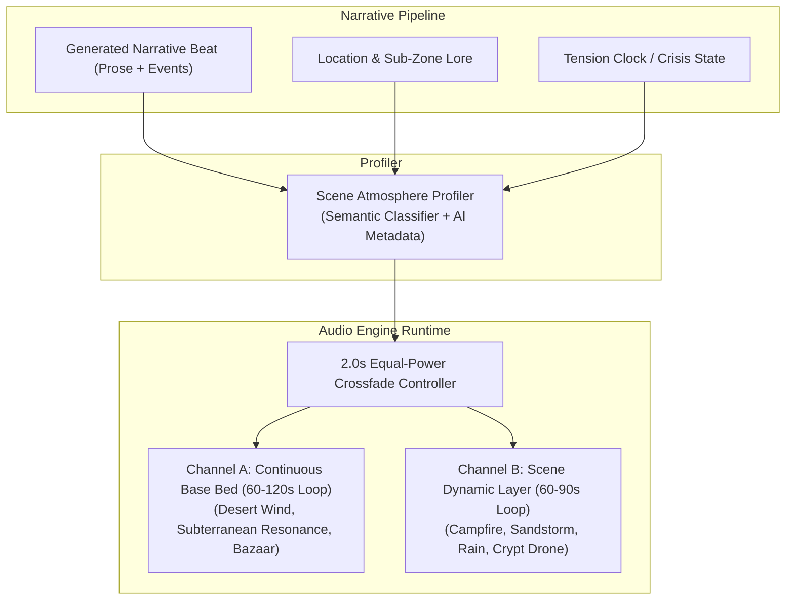

# Plan 16: Scene-Aware Dynamic Audio & Immersive Soundscapes

Transform StoryForge's acoustic layer from short, repetitive static audio loops into a living, intelligent, multi-layered soundscape engine that dynamically adapts to narrative context, location biomes, environmental weather, and scene tension across both Web and Flutter applications.

---

## 1. Executive Summary & Problem Analysis

### 1.1 The Current Limitations
In the current implementation:
1. **Short, Jarring Audio Loops**: The existing ambient files (`ambient_citadel_wind.wav`, `ambient_dungeon_drips.wav`, `ambient_crypt_drone.wav`) are 3-to-6 second uncompressed PCM `.wav` files. The repetition loop point is immediately noticeable and quickly causes player auditory fatigue.
2. **Naive Keyword Matching**: Both Web ([`web/src/lib/play/audioService.ts`](file:///g:/Code/StoryForge/web/src/lib/play/audioService.ts#L30-L40)) and Flutter ([`app/lib/services/audio_service.dart`](file:///g:/Code/StoryForge/app/lib/services/audio_service.dart#L26-L36)) determine ambient tracks solely through naive substring checks on `locationId` (e.g., `loc.contains('dungeon')`).
3. **Complete Scene Blindness**: The audio player is deaf to the actual narrative beat. If the player sits by a crackling caravan campfire under the desert stars, hides from a violent sandstorm in a tent, enters a bustling bazaar, or engages in a tense standoff, the game still defaults to the same generic wind sound.
4. **Abrupt Transitions**: Switching locations causes hard cuts or abrupt silence without natural cross-fading.

### 1.2 The Paradigm Shift: Dynamic Living Soundscapes
Interactive fiction gains cinematic immersion when the acoustic environment mirrors the author's prose:
- A scene set in the Hiram desert at night should play gentle night winds with distant dunes and desert insects.
- A rest beat around the caravan should layer warm crackling wood embers and quiet murmurs.
- A sudden sandstorm crisis should swell into ferocious howling gales.
- An underground subterranean crypt should reverberate with low-frequency spatial resonance.



---

## 2. Core Pillars & Architecture

### Pillar 1: Semantic Atmosphere & Scene Audio Profiler
Instead of relying solely on raw `locationId`, each turn beat is evaluated to determine its primary **Soundscape Profile** and optional **Atmospheric Modifier Layer**.

#### Atmosphere Taxonomy
| Profile ID | Acoustic Character | Trigger Contexts |
| :--- | :--- | :--- |
| `desert_wind_calm` | Soft desert night breeze, faint shifting sands, distant stillness | Hiram badlands, open road, salt flats, desert night |
| `sandstorm_violent` | Ferocious howling arid wind, grit hitting canvas and stone | Sandstorms, high-danger desert displacement, storm hazards |
| `campfire_caravan` | Warm crackling wood embers, quiet nocturnal insects, subtle leather/camel rustles | Caravansary stops, encampments, rest turns, evening dialogue |
| `subterranean_depths` | Cavernous acoustic room tone, distant water drips, hollow stone resonance | Caves, dungeons, sewer escape, underground rivers |
| `ancient_crypt_occult` | Low sub-bass hum, ominous resonance, eerie whisper drafts | Forbidden vaults, altars, necropolises, ancient ruins |
| `bustling_bazaar_tavern` | Muffled crowd chatter, distant footsteps, ceramic/flagon clinking | Caravansary markets, city gates, taverns, trading posts |
| `rain_thunderstorm` | Heavy rain drumming on earth/stone, distant thunder rumbles | Mountain storms, tempest events, oasis rainfall |
| `tense_confrontation` | Low pulsing tension drone, muted heartbeats, heightened silence | Boss encounters, crisis events, standoff checks |
| `silent_shrine_oasis` | Gentle water ripples, rustling desert reeds, serene stillness | Desert springs, sacred shrines, secluded sanctuaries |

#### Dual-Resolution Strategy
1. **AI Generation Tagging**: The narrative engine's schema can include an optional `audioAtmosphere` property in `beat`.
2. **Deterministic Semantic Fallback**: A high-speed client-side and server-side text profiler scans `narrativeProse` for keywords (e.g. fire/flame/hearth ➔ `campfire_caravan`; storm/sand/howl ➔ `sandstorm_violent`; drops/dungeon/cells ➔ `subterranean_depths`) combined with location type and active danger clocks. If no specific modifier is found, it falls back to the location's biome default.

---

### Pillar 2: High-Fidelity 60s–120s Seamless Asset Library
Modern compressed audio formats offer vastly superior fidelity at a fraction of the file size of uncompressed WAV files:

- **Format**: High-efficiency stereo `.ogg` (Vorbis/Opus) for Web and Android, with `.mp3` / `.m4a` fallback.
- **Duration**: 60 to 120 seconds per track, engineered with zero-crossing seamless loop points.
- **Bitrate**: 96 to 128 kbps stereo.
- **Efficiency Metric**:
  - *Previous 6-second WAV*: ~1.2 MB.
  - *New 90-second high-fidelity OGG*: **~850 KB - 1.1 MB**.
  - A comprehensive suite of **10 distinct ambient soundscapes requires under 10 MB total**, staying far below the project's 30 MB large file download limit while eliminating loop predictability.

---

### Pillar 3: Dual-Channel Layered Playback
To create living, non-static acoustic environments, the audio engine runs two coordinated channels:
1. **Channel A (Base Bed)**: The broad environmental foundation (e.g., general desert ambient or cavern acoustics).
2. **Channel B (Dynamic Element)**: Scene-specific contextual modifiers (e.g., crackling campfire, storm intensity, or crowd murmur).

Both channels can be balanced independently (e.g. Bed at 70% volume, campfire crackle at 40% volume) and can fade in or out independently as the narrative progresses.

---

### Pillar 4: 2.0s Equal-Power Smooth Crossfade Manager
Abrupt cuts between scenes break player focus.
- **Crossfade Window**: When transitioning between different soundscape profiles, the outgoing track smoothly fades out over 1.5 to 2.0 seconds while the incoming track fades in.
- **Idempotency Guard**: If the player advances from Turn 3 to Turn 4 and both turns remain in the `desert_wind_calm` profile, the audio player does **not** restart the track. It continues playing seamlessly across turn boundaries.

---

## 3. Data Models & API Contracts

### 3.1 Shared TypeScript Definition ([`web/src/lib/types/audio.ts`](file:///g:/Code/StoryForge/web/src/lib/types/audio.ts))
```ts
export type AmbientProfileId =
  | 'desert_wind_calm'
  | 'sandstorm_violent'
  | 'campfire_caravan'
  | 'subterranean_depths'
  | 'ancient_crypt_occult'
  | 'bustling_bazaar_tavern'
  | 'rain_thunderstorm'
  | 'tense_confrontation'
  | 'silent_shrine_oasis'
  | 'none';

export interface SceneAudioAtmosphere {
  baseBed: AmbientProfileId;
  dynamicLayer?: AmbientProfileId;
  intensity?: 'calm' | 'moderate' | 'intense';
}
```

### 3.2 Flutter Dart Model ([`app/lib/models/audio_atmosphere.dart`](file:///g:/Code/StoryForge/app/lib/models/audio_atmosphere.dart))
```dart
enum AmbientProfile {
  desertWindCalm('desert_wind_calm', 'assets/audio/ambient/ambient_desert_wind_calm.ogg'),
  sandstormViolent('sandstorm_violent', 'assets/audio/ambient/ambient_sandstorm_violent.ogg'),
  campfireCaravan('campfire_caravan', 'assets/audio/ambient/ambient_campfire_caravan.ogg'),
  subterraneanDepths('subterranean_depths', 'assets/audio/ambient/ambient_subterranean_depths.ogg'),
  ancientCryptOccult('ancient_crypt_occult', 'assets/audio/ambient/ambient_crypt_occult.ogg'),
  bustlingBazaarTavern('bustling_bazaar_tavern', 'assets/audio/ambient/ambient_bazaar_tavern.ogg'),
  rainThunderstorm('rain_thunderstorm', 'assets/audio/ambient/ambient_rain_thunderstorm.ogg'),
  tenseConfrontation('tense_confrontation', 'assets/audio/ambient/ambient_tense_confrontation.ogg'),
  silentShrineOasis('silent_shrine_oasis', 'assets/audio/ambient/ambient_oasis_shrine.ogg'),
  none('none', '');

  final String id;
  final String assetPath;
  const AmbientProfile(this.id, this.assetPath);
}
```

---

## 4. Implementation Phases

### Phase 1: Semantic Atmosphere Profiler
1. Create a deterministic atmospheric classifier in `web/src/lib/engines/narrative/atmosphereClassifier.ts`:
   - Inspects `narrativeProse`, active location `type`/`tags`, hazard displacement state, and tension clock status.
   - Resolves the active `SceneAudioAtmosphere`.
2. Include resolved atmosphere in the turn response payload:
   - `data.beat.atmosphere` in `/api/play/action` and `/api/play/session`.

### Phase 2: Web Audio Service Upgrade ([`web/src/lib/play/audioService.ts`](file:///g:/Code/StoryForge/web/src/lib/play/audioService.ts))
1. Implement a dual-audio element crossfader with Web Audio API (`GainNode`) or smoothed interval volume ramps.
2. Maintain active track state across turns without re-triggering when profiles match.
3. Support master ambient volume slider and mute controls.

### Phase 3: Flutter Audio Service Upgrade ([`app/lib/services/audio_service.dart`](file:///g:/Code/StoryForge/app/lib/services/audio_service.dart))
1. Upgrade `AudioService` with two coordinated `AudioPlayer` instances (primary & secondary crossfader).
2. Implement `crossfadeTo(AmbientProfile newProfile, {Duration duration = const Duration(milliseconds: 1800)})`.
3. Wire `gameSessionProvider` to trigger atmosphere updates on every new beat.

### Phase 4: Asset Curation & Seamless Loop Mastering
1. Curate and master 8 to 10 high-quality, royalty-free CC0/licensed atmospheric field recordings (60s to 90s each).
2. Apply smooth zero-crossing loop fades in Audacity / FFmpeg.
3. Encode into optimized `.ogg` (quality level ~4, 96-128 kbps).
4. Place files in `web/public/audio/ambient/` and `app/assets/audio/ambient/` (updating `pubspec.yaml` asset paths).

---

## 5. Acceptance Criteria

- [ ] **Loop Inaudibility**: Ambient tracks play continuously for 5+ minutes with zero audible seam, pop, or obvious rhythmic pattern.
- [ ] **Contextual Realism**: A campfire scene in the desert plays crackling embers and night wind; moving into an ancient ruin transitions to cavernous, dripping stone reverb.
- [ ] **Seamless Crossfading**: Transitioning between two different environments executes a smooth 1.8s volume crossfade without clicks or silence.
- [ ] **No Restart on Same Ambient**: Advancing turns within the same environment preserves uninterrupted track playback.
- [ ] **Lightweight Footprint**: The entire bundle of ambient assets remains under 10 MB total across the app.
- [ ] **Cross-Platform Parity**: Identical audio atmosphere resolution and smooth cross-fading behavior on both Web and Flutter.
