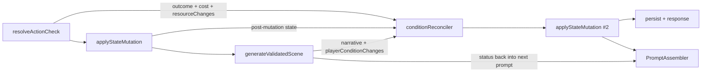

# Plan 17: Player Status Authority — Prose-Synced Conditions & Inter-City Travel State

Make the player status bar a faithful mirror of the story: if the prose says the protagonist is wounded, the tag says wounded; if a wound is bandaged, the tag says treated; if the protagonist is on the road between two cities, the status shows `traveling → destination: City X` with a real ETA. One authoritative `PlayerState`, deterministic writers, both clients rendering exactly what the state contains, and the writer LLM receiving the status back as binding context on every following turn.

This plan is the direct continuation of Plan 15 (Pillar 4, Living Vitality Bar) and finalizes the work items left open by the reader status investigation: condition sync gaps, the Flutter heuristic fallbacks, the missing micro-location projection, and the new inter-city travel state.

---

## 1. Executive Summary & Problem Diagnosis

### 1.1 What exists today

| Layer | Current implementation | File |
| :--- | :--- | :--- |
| State shape | `PlayerState.conditions: string[]` — raw tags, no catalog, no severity, no treated flag; `currentLocationId` + `currentSubZoneId` | [`gameplay.ts`](file:///g:/Code/StoryForge/web/src/lib/types/gameplay.ts#L82-L88) |
| State writer | Only `applyStateMutation` auto-derivation: `زخمی` at HP ≤ 35 %, `خسته` at stamina ≤ 20 %, `تشنه` via a hardcoded water-clock id | [`stateMutationEngine.ts`](file:///g:/Code/StoryForge/web/src/lib/engines/game/stateMutationEngine.ts#L108-L162) |
| Writer output | `GeneratedSceneResponse` = `{ narrative, choices, extractedMemories, encounteredCreatureId }` — **no condition channel** | [`GeminiAdapter.ts`](file:///g:/Code/StoryForge/web/src/lib/providers/GeminiAdapter.ts#L21-L25) |
| Diff contract | `conditionsAdded` / `conditionsRemoved` / `conditions` exist but **no production code populates them** | [`gameplay.ts`](file:///g:/Code/StoryForge/web/src/lib/types/gameplay.ts#L156-L161) |
| Prompt ingestion | Conditions injected into the prompt as prose guidance + a "wound beat" for untreated injuries | [`PromptAssembler.ts`](file:///g:/Code/StoryForge/web/src/lib/engines/narrative/PromptAssembler.ts#L266-L276) |
| Flutter renderer | Registry chips **plus invented fallback chips** (`تندرست`, `پایدار`, `هوشیار`, `ناآشنا`) derived from HP/stamina/discovered count | [`condition_chips.dart`](file:///g:/Code/StoryForge/app/lib/ui/widgets/condition_chips.dart#L159-L268) |
| Web renderer | Registry-only chips, no invented baselines | [`CharacterConditionChips.tsx`](file:///g:/Code/StoryForge/web/src/components/play/CharacterConditionChips.tsx) |
| Location writes | Authored-beat `locationId`, hazard displacement, defeat relocation — **no free-form travel state** | [`action/route.ts`](file:///g:/Code/StoryForge/web/src/app/api/play/action/route.ts#L575-L615) |
| Travel validation | Travel intent is validated against `connectedLocationIds` / parent-child / active trade routes, then discarded | [`ActionValidator.ts`](file:///g:/Code/StoryForge/web/src/lib/engines/validator/ActionValidator.ts#L191-L231) |

### 1.2 Six concrete failure modes

1. **Invented wound.** The writer can narrate a gash on the protagonist's forearm, but there is no structured channel for it, so `PlayerState.conditions` never learns about it. The very next scene and the status bar disagree with the prose that just rendered.
2. **Narrated wound erased.** `stateMutationEngine` removes `زخمی` the moment `hpRatio >= 0.70` (`stateMutationEngine.ts:138`). A potion, a long rest, or a level-up heal silently deletes a wound the story explicitly described — even one taken this same turn.
3. **Hardcoded pools.** Auto-derivation reads `resources['hp']` and `resources['stamina']` unconditionally. Stories whose primary pool is `health` (or any Studio-authored id) never derive conditions; `resourcePools.resolveHealthKey` already exists for exactly this and is not used here.
4. **Client invention.** `_deriveBodyConditions` / `_deriveMindConditions` fabricate `تندرست و قبراق` / `هوشیار و مراقب` from HP ratios and `discoveredLocationIds.length`. The status bar can show "vigorous and unwounded" while the prose describes a bleeding shoulder — the exact contradiction the user reported.
5. **Treated/untreated blindness.** There is no notion of treatment. The wound beat at `PromptAssembler.ts:268-276` matches any tag containing `زخم`, so a bandaged wound keeps triggering "the protagonist suffered an **untreated** injury… allies must bandage it" — a continuity loop. Conversely, once the UI decides a wound is no longer displayed, the prompt loses it entirely.
6. **Micro-location never renders.** `buildPlayLore` strips `subZones` and `pointsOfInterest` from the player-safe projection ([`session/route.ts:30-46`](file:///g:/Code/StoryForge/web/src/app/api/play/session/route.ts#L30-L46)), so `GameSessionState.locationWithSubZone` never finds a sub-zone name and the "Macro • Micro" bar silently degrades to macro-only.

### 1.3 The missing journey state ("between cities")

Today a validated "I travel to Sunstone Citadel" action has nowhere to live:

- `currentLocationId` only moves via an **authored beat** (`§3½` of the action route), a **hazard displacement**, or a **defeat relocation**. A free-form travel action passes `ActionValidator.checkMovementPlausibility` and then… stays where it is, turn after turn, while the writer may narrate the destination anyway (teleporting the prose).
- There is no ETA, no road scene, no corridor scoping for the world envelope, no arrival event, no vocabulary for "on the road", and therefore nothing the status bar can show.
- The user's requested contract: **`traveling → destination: City X`**, persistent across turns, visible in both clients, and binding on the narrative until arrival.

### 1.4 Goals & non-goals

**Goals**
- Prose-authoritative conditions: any bodily/mental state the story depicts is reflected in `PlayerState.conditions` within the same turn, and vice versa.
- Treated vs untreated wounds with a stable canonical tag vocabulary.
- Deterministic inter-city travel: intent detection → journey plan (waypoints, ETA) → road turns → arrival, persisted in `PlayerState` (JSON only, no DB migration).
- Both status bars (Flutter + web) render server truth only; no invented chips.
- Active status (conditions + travel) feeds the next turn's prompt, world scope, and a small deterministic mechanics set, so it truly shapes the narrative.

**Non-goals**
- No tactical travel combat, no caravan economy rework (Plan 10 owns trade routes/economy).
- No map UI in the reader (cartographer remains Studio-side); travel uses authored coordinates only for ETA estimation.
- No new Prisma models or columns.

---

## 2. Design Principles

1. **Prose is king, state is authoritative.** The writer's prose is the source of truth for what happened; the server reconciles state from the prose deterministically within the same turn. Both the prose and the state come out of the turn agreeing.
2. **Deterministic writers, LLM narrator.** Same philosophy as Plan 15 §7.6 (`movementEngine`): the model narrates and *declares*; typed engines derive, validate, and write state. No model-authored state values are trusted verbatim.
3. **No client invention (AGENTS rule).** Clients render `playerState.conditions` and `playerState.travel` exactly. If a state must always be displayed, the **server** seeds it (e.g. baseline `تندرست`), not the UI.
4. **Backward compatible by encoding.** Canonical tags remain the existing Persian strings (`زخمی`, `تشنه`, …) so old sessions, old clients, and existing prompt logic keep working; English `kind` names exist only in the writer contract and the catalog.
5. **Rewind/remake safe by construction.** Travel progress is a pure function of `(departedTurn, turnNumber, totalTurns)` — no mutable countdown. Remakes regenerate prose, not journey arithmetic.
6. **Cross-platform parity.** Every contract addition lands in the TypeScript types, the Dart models, the web UI, and the Flutter UI in the same plan, with mirrored tests.
7. **Gated rollout.** `ENABLE_CONDITION_RECONCILER` and `ENABLE_TRAVEL_STATE` environment flags, default off until acceptance criteria pass; ship as patch `1.0.8`.

---

## 3. Part A — Authoritative Condition Pipeline

### 3.1 Condition catalog

New module: `web/src/lib/engines/game/conditionCatalog.ts`.

The catalog is the single source of truth mapping the writer's English `kind` to the canonical tag stored in `PlayerState.conditions`, with display metadata, closure rules, and prompt guidance.

| kind (writer contract) | canonical tag | zone | implies | treated variant | notes |
| :--- | :--- | :--- | :--- | :--- | :--- |
| `wounded` | `زخمی` | body | — | `زخمی (پانسمانشده)` | wound beat + bodily-risk costs |
| `bleeding` | `خونریزی` | body | `wounded` | — | removed when treated; never alone |
| `exhausted` | `خسته` | body | — | — | stamina-derived + prose-derived |
| `thirsty` | `تشنه` | body | — | — | water-clock derived + prose-derived |
| `poisoned` | `مسموم` | body | — | `مسموم (پادزهرخورده)` | clock-driven drain stays in `threatClock` |
| `dazed` | `گیج` | mind | — | — | blunt trauma / shock |
| `shaken` | `شوکزده` | mind | — | — | terror, grief, near-death |
| `vigilant` | `هوشیار` | mind | — | — | only if the prose depicts alertness as a state |
| `outsider` | `ناآشنا` | situational | — | — | seeded at session start when the story begins in a foreign land |
| `resolute` | `مصمم` | mind | — | — | |
| `suspected` | `مظنون` | situational | — | — | |
| `baseline` | `تندرست` | body | — | — | server-seeded "unencumbered"; prompt-silent |
| `custom` | raw string | — | — | — | writer can pass any other phrase; stored verbatim, rendered raw |

Public API:

```ts
export type ConditionKind = 'wounded' | 'bleeding' | 'exhausted' | 'thirsty'
  | 'poisoned' | 'dazed' | 'shaken' | 'vigilant' | 'outsider' | 'resolute'
  | 'suspected' | 'baseline' | 'custom';

export interface ConditionDef {
  kind: ConditionKind;
  tag: string;                    // canonical Persian tag
  zone: 'body' | 'mind' | 'situational';
  implies?: ConditionKind[];      // closure rules (bleeding -> wounded)
  treatedTag?: string;            // e.g. 'زخمی (پانسمانشده)'
  promptSilent?: boolean;         // baseline: never injected into the prompt
  narrativeGuidance: { en: string; fa: string };
}

export function resolveKind(kind: string): ConditionDef;            // unknown -> custom
export function tagForKind(kind: string): string;                   // kind -> canonical tag
export function kindForTag(tag: string): ConditionDef | null;       // tolerant, FA + EN aliases
export function isTreated(tag: string): boolean;                    // '(پانسمانشده)' | '(درمانشده)' suffix
export function markTreated(tag: string): string;                   // idempotent
export function closeImplied(tags: string[]): string[];             // bleeding => wounded
export function normalizeConditions(tags: string[]): string[];      // trim/dedupe/closures
```

Also exports `CONDITION_PROSE_PATTERNS` (EN/FA regexes for wound/bleed/treat/heal/poison/exhaustion/thirst/daze/shock, plus negation guards) consumed by the reconciler.

### 3.2 Writer contract: `playerConditionChanges`

Add a fourth field to the **two main scene schemas** (English around [`PromptAssembler.ts:343`](file:///g:/Code/StoryForge/web/src/lib/engines/narrative/PromptAssembler.ts#L342-L354), Persian around `PromptAssembler.ts:403`). The choice-architect schemas (`PromptAssembler.ts:786`, `:918`) are unchanged — they must not write state.

```jsonc
{
  "narrative": "...",
  "encounteredCreatureId": null,
  "playerConditionChanges": {
    // Only conditions ACTUALLY DEPICTED in the narrative above. Empty arrays when nothing changed.
    "add":    [ { "kind": "wounded", "severity": "moderate", "source": "the shard opened a gash on your left forearm" } ],
    "treat":  [ { "kind": "wounded", "method": "you tear a strip of cloth and bind the gash" } ],
    "remove": [ { "kind": "bleeding", "reason": "the pressure stops the bleeding" } ]
  },
  "choices": [ ... ],
  "extractedMemories": [ ... ]
}
```

Hard rules written into both prompts (EN + FA):

- **Evidence rule.** Every listed change must be visible in the prose of this exact turn. Never declare a wound you did not write; never write a wound and omit it from the list.
- **Treatment rule.** Bandaging, splinting, poultices, or a healer's care → `treat`, not `remove`. A wound is only `remove`d on genuine healing (magic, medicine over time, a full rest convalescence) explicitly narrated.
- **Bleeding rule.** `bleeding` may be added alongside `wounded` when the prose shows active blood loss, and removed (via `treat`) when the bleeding is stopped. `bleeding` is never `remove`d without treatment prose.
- **No NPC/party conditions** in this channel (player only); NPC wounds stay narrative/relationship material.
- **No mechanical numbers** — severity is a narrative word (`minor|moderate|severe`), not an HP delta.

### 3.3 Adapter normalization

- `GeneratedSceneResponse` ([`GeminiAdapter.ts:21`](file:///g:/Code/StoryForge/web/src/lib/providers/GeminiAdapter.ts#L21-L25)) gains `playerConditionChanges?: RawConditionChanges`.
- `SceneAiResponse` ([`narrativeTurn.ts:77`](file:///g:/Code/StoryForge/web/src/lib/engines/narrative/narrativeTurn.ts#L77-L83)) mirrors it.
- New `normalizeConditionChanges(raw)` in the adapter: resolves `kind` through the catalog (unknown → `custom` with the raw phrase), trims/dedupes, caps at 4 adds / 4 removes, drops entries with empty evidence text, sanitizes control characters. Runs inside `generateSceneWithRaw` exactly like `normalizeChoices` / `normalizeExtractedMemories`.
- Mock scenes return no changes (never invent state offline).

### 3.4 Deterministic reconciler

New module: `web/src/lib/engines/game/conditionReconciler.ts`.

```ts
export interface ConditionReconciliation {
  /** Diff to apply via applyStateMutation. Empty object when nothing changed. */
  diff: Pick<StateMutationDiff, 'conditionsAdded' | 'conditionsRemoved' | 'conditions'>;
  /** Final normalized list after reconciliation (for response transparency). */
  conditions: string[];
  /** Telemetry: dropped declarations, inferred wounds, treatments, conflicts. */
  findings: Array<{
    type: 'declared_unsupported' | 'undeclared_wound' | 'removal_unsupported'
        | 'treated' | 'healed' | 'seeded_baseline' | 'conflict';
    kind: string;
    detail: string;
  }>;
}
```

**Inputs:** `prose`, `declared` changes, `previousConditions` (pre-turn), `playerState` (post-mechanical-mutation), `resolution` (outcome, cost line, `resourceChanges`), `rpgSystem`, `language`.

**Algorithm (ordered, deterministic):**

1. **Negation guard.** Strip/flag clauses that negate: `unharmed`, `untouched`, `without a scratch`, `no wound`, `نخوردهام`, `بدون زخم`, `آسیبی ندیدهام`. A wound word inside a negated clause is not evidence.
2. **Evidence extraction** from prose using `CONDITION_PROSE_PATTERNS`:
   - wound: `wound|gash|cut|slash|stab|laceration|bruise|sprain|limp|جراحت|زخم|شکاف|بریدگی|کبودی|پیچخوردگی|لنگیدن`
   - bleeding: `blood|bleeding|dripping red|خون|خونریزی` (excludes metaphorical "blood of my enemies" when not adjacent to the protagonist pronoun — cheap pronoun window check)
   - treatment: `bandage|bind|wound tightly|splint|poultice|stitch|باند|پانسمان|بستن زخم|آتل|مرهم|بخیه`
   - healing: `healed|knit|closed|mended|التیام|بهبود|درمان|جوش خوردن`
   - poison, exhaustion, thirst, daze, shock, vigilance per catalog patterns.
3. **Declaration merge** (declared vs evidence):

   | Case | Rule |
   | :--- | :--- |
   | `add` declared **and** evidenced | Add canonical tag (closure applies). |
   | `add` declared, **not** evidenced | Drop; emit `declared_unsupported`. |
   | Wound evidenced, **not** declared, and the turn's outcome/cost implies bodily harm (`resourceChanges[healthKey] < 0`, or `mixed_success`/`failure` on a bodily-risk action per `actionCheckEngine.isBodilyRiskAction`) | Auto-add `زخمی`; emit `undeclared_wound`. |
   | Wound evidenced with no mechanical cost at all (pure prose accident, e.g. a narrated stumble) | Add `زخمی` only when the prose is explicit (bleeding or a named injury); otherwise remember as a narrative memory without a condition; emit `undeclared_wound` with `evidence: weak` telemetry. |
   | `remove` declared **and** healing evidenced | Remove canonical tag (and its treated variant); emit `healed`. |
   | `remove` declared, **no** healing evidence | Keep; emit `removal_unsupported`. |
   | `treat` declared **and** treatment evidenced | Replace `زخمی` with the treated variant; `خونریزی` removed (bleeding stopped); emit `treated`. |
   | `treat` declared, no treatment evidence | Keep untreated; emit `declared_unsupported`. |
   | Any **explicit contradiction** (state says `زخمی` untreated from a previous turn, prose this turn explicitly says the wound is gone while the writer declared no change) | Repair-lite: since prose is king, apply `remove`; emit `conflict`. This is the "story healed you" path and closes the loop without a second model call. |

4. **Closure.** `خونریزی` ⇒ `زخمی`; treated variant never coexists with its untreated twin; `تندرست` never coexists with any body condition.
5. **Baseline upkeep.** When the body zone ends the turn empty and `hpRatio >= 0.70 && staminaRatio >= 0.60`, add `تندرست` (`seeded_baseline`). When any body condition is active, remove `تندرست`. `تندرست` is `promptSilent`.
6. **Output.** Build the minimal diff: `conditionsAdded`, `conditionsRemoved`, and a full `conditions` overwrite only when the reconciliation produced removals that the auto-derivation might otherwise re-add. The route applies it with a second `applyStateMutation` call.
7. **Telemetry.** Log `findings` to the server console (and include them in `resolution.conditionChanges` for the eval harness); no DB writes required.

**Where it runs:**
- `action/route.ts` after `generateValidatedScene` returns OK, before persistence/response (single-model-turn loop; the narrating model never needs a second call).
- `aotBranchEngine.ts` when a pre-written branch is materialized: run the same reconciler against the branch's predicted prose + declaration and the branch's final state. The Plan 15 AOT gate ("audited before serving") applies unchanged.
- `narrativeTurn.ts` simply exposes `aiResponse.playerConditionChanges`; it does not mutate state itself.

`ProseValidator` gains one optional finding category `condition_conflict` used only for telemetry in this plan (the reconciler already resolves conflicts by prose-first removal; no repair round-trip by default).

### 3.5 `stateMutationEngine` guards

Four surgical fixes to [`stateMutationEngine.ts`](file:///g:/Code/StoryForge/web/src/lib/engines/game/stateMutationEngine.ts):

1. **Resolve real pools.** Replace `updated.resources['hp']` and `['stamina']` with `resolveHealthKey(rpgSystem)` and a new `resolveStaminaKey(rpgSystem)` in `resourcePools.ts` (mirror `resolveHealthKey`; fallback order: authored primary resource → id containing `stamina` → `stamina`). Same for `maxResources`.
2. **No more silent wound erasure.** Auto-remove `زخمی` only when both hold:
   - the resource ratio **crossed** from the danger zone to recovery this turn (needs the pre-mutation snapshot — extend `applyStateMutation(current, diff, rpgSystem, options?: { previousState?: PlayerState })` and pass the pre-turn state from the route), **and**
   - the turn did not narrate/declare the wound (`diff.conditionsAdded` for that kind is absent).
   A wound taken at HP 80 % and still untreated at HP 85 % is never auto-removed; only the reconciler's evidence-based removal clears it. Same principle for `خسته` and `تشنه`.
3. **Explicit removal suppresses auto-add.** If a kind is present in `diff.conditionsRemoved` (or absent from a `diff.conditions` overwrite), do not auto-add it in the same turn.
4. **Kill the magic water clock id.** Replace the `mtpqnxvl_jdgi` substring check with the clock metadata: any clock whose name matches `آب|water|عطش|thirst` or whose id is `clock_<currentLocationId>` with `threatClockDefault` matching thirst semantics. `تشنه` remains derived from that clock plus reconciler evidence.

### 3.6 Prompt ingestion & wound beat

- `PromptAssembler.ts:480` / `:507` condition lines gain the treated annotation from the catalog, and `تندرست` is skipped (`promptSilent`). Example injected line: `• Active Character Conditions: زخمی (پانسمانشده) — treated, do not re-open; تشنه — parched, emphasize`.
- Wound beat (`PromptAssembler.ts:268-276`): select the first wound tag where `!isTreated(tag)`. Treated wounds never trigger the "allies must bandage" directive; they instead get a one-line continuity guard (`the wound is bound; physical strain still aches`). This is the single highest-value fix for the wound-continuity loop.
- `ProseValidator` COST_WORDS unchanged.

### 3.7 Turn flow (Part A)



### 3.8 Client rendering contracts

**Flutter — [`condition_chips.dart`](file:///g:/Code/StoryForge/app/lib/ui/widgets/condition_chips.dart):**
- Delete `_deriveBodyConditions` / `_deriveMindConditions` fallback synthesis entirely (keep only registry/filter helpers). The bar renders:
  - server conditions (catalog-matched or raw `Icons.tag_outlined` for custom),
  - treated wounds with a bandage icon (`Icons.healing_rounded` or `Icons.bandage`) and muted rose styling,
  - no condition chips when the server list is empty (location/travel chips still render; the server seeds `تندرست` at session start so a fresh healthy character still shows a body state).
- `ConditionMeta` gains an optional `treated?: boolean` / `customNotes` so tooltips stay honest (`«زخمی — پانسمانشده؛ حرکت سنگین دردناک است.»`).
- Add test coverage proving no chip can render that is not in `playerState.conditions`.

**Web — [`CharacterConditionChips.tsx`](file:///g:/Code/StoryForge/web/src/components/play/CharacterConditionChips.tsx):**
- Add the canonical tags missing from `CONDITION_REGISTRY` (`خونریزی`, `تندرست`, `مصمم`, `شوکزده`) with the same styling language.
- Parse the `(پانسمانشده)` / `(درمانشده)` suffix and render a treated variant (bandage icon, non-pulsing).
- Unknown tags render as a neutral chip with the raw label (already the component's fallback behavior — verify and keep).
- **Optional parity hardening:** generate the registry from a shared JSON checked into `web/src/lib/engines/game/conditionCatalog.ts` + a small Dart constant file, with a unit test in each repo asserting the two registries cover the same canonical keys. Manual mirroring is acceptable for this plan but the test protects drift.

**Lore projection fix (prerequisite):** [`session/route.ts buildPlayLore`](file:///g:/Code/StoryForge/web/src/app/api/play/session/route.ts#L30-L46) must include:
```ts
subZones: (l.subZones ?? []).map((sz: any) => ({ id: sz.id, name: sz.name, subType: sz.subType })),
pointsOfInterest: (l.pointsOfInterest ?? []).map((p: any) => ({ id: p.id, name: p.name })),
parentLocationId: l.parentLocationId || undefined,
region: l.region || undefined,
```
so `GameSessionState.locationWithSubZone` resolves `Macro • Micro` (and travel waypoint names) on the client.

### 3.9 Deterministic effects (narrative-first, gated)

The writer prompt already mandates sensory reflection of conditions; this plan keeps **narrative reconciliation** as the primary effect and adds a minimal, catalog-flagged mechanical set behind `conditionEffects` (Phase 7, default on for the body zone only):

| Condition | Deterministic effect | Enforcement point |
| :--- | :--- | :--- |
| `زخمی` (untreated) | +25 % stamina cost on bodily-risk mixed failures; existing HP cost unchanged | `actionCheckEngine` cost table |
| `زخمی (پانسمانشده)` | +10 % stamina cost | same |
| `خسته` | −1 to physical-stat checks (clamped ≥ 0) | `resolveActionCheck` modifier |
| `تشنه` | One extra threat-clock segment on desert/harsh travel turns | clock tick in `actionCheckEngine` |
| `مسموم` | Existing per-turn clock drain unchanged | `threatClock` engine |

Each effect is declared on the catalog entry so disabling a kind's effect is a one-line change; no hidden magic numbers outside the catalog table.

---

## 4. Part B — Inter-City Travel State

### 4.1 Data model

**TypeScript** ([`gameplay.ts`](file:///g:/Code/StoryForge/web/src/lib/types/gameplay.ts)):

```ts
export type TravelMode = 'foot' | 'mount' | 'caravan' | 'ship';

export interface ActiveTravel {
  originLocationId: string;
  destinationLocationId: string;
  /** Trade route followed when the journey uses one (Plan 10 routes). */
  routeId?: string;
  /** Ordered intermediate location stops (excludes origin + destination). */
  waypointIds?: string[];
  mode: TravelMode;
  /** Absolute session turn number when the journey began. */
  departedTurn: number;
  /** Total legs of the journey; 2..6 by the pacing clamp. */
  totalTurns: number;
  /** Caravan / escort NPC ids travelling with the protagonist on this journey. */
  caravanNpcIds?: string[];
}

export interface PlayerState {
  // ...existing fields
  /** Plan 17: active inter-city journey. Absent/null = grounded at currentLocationId. */
  travel?: ActiveTravel | null;
}

export interface StateMutationDiff {
  // ...existing fields
  /** Plan 17: journey start/replace; null cancels the journey at the current stop. */
  travel?: ActiveTravel | null;
}
```

**Dart** ([`game_state.dart`](file:///g:/Code/StoryForge/app/lib/models/game_state.dart)): mirror `ActiveTravel` with `fromJson` / `toJson` / `copyWith`, nullable `PlayerState.travel`, and round-trip test parity.

**Persistence:** `PlaythroughSession.playerState` is JSON (`schema.prisma:211`) — **no migration**. Old sessions simply have `travel == null`.

### 4.2 Journey timeline and derived ETA (rewind-safe)

```
timeline nodes: [origin, ...waypointIds, destination]
legsElapsed   = clamp(turnNumber - departedTurn, 0, totalTurns)
turnsRemaining = totalTurns - legsElapsed
currentStopIndex = min(legsElapsed, waypointIds.length)
arrival        = turnsRemaining === 0
```

- No mutable countdown is stored; the entire progress derives from the absolute turn number. A remake/rewind regenerates prose from the same arithmetic. Forced marching stores a reduced `totalTurns` in that turn's resolution diff (which the remake flow already reverts).
- `currentLocationId` during travel = `timeline[currentStopIndex]` (origin for direct 2-node journeys until the final turn). Discovery: every node reached is pushed to `discoveredLocationIds`.
- On the **arrival turn**, processing runs *before* `generateValidatedScene` (same slot as the §3½ authored-beat move): `currentLocationId = destination`, `travel = null`, discovered updated, destination threat clock seeded via the existing `ensureClockForLocation`, and the generation input carries `travelArrival: { from, to }` so the writer narrates the arrival with the correct envelope scope.

### 4.3 `travelEngine.ts` (new, deterministic)

New module: `web/src/lib/engines/game/travelEngine.ts`, registered on `GameEngine` like `detectSubZoneChange`.

```ts
export interface JourneyPlan {
  destinationLocationId: string;
  routeId?: string;
  waypointIds: string[];
  mode: TravelMode;
  totalTurns: number;
  dangerLevel: number;
  /** Prose-ready summary line (localized). */
  note: string;
}

/** Shared travel-intent regex, extracted from ActionValidator.checkMovementPlausibility. */
export function detectTravelIntent(actionText: string, isPersian: boolean): boolean;

/** Resolve a named destination from the action text (normalized FA/EN matching). */
export function resolveDestinationName(
  actionText: string, wb: WorldBible, currentLocationId: string
): WorldLocation | null;

/** True when destination is directly reachable: connected, parent/child, or non-blockaded route stop. */
export function isDirectlyReachable(originId: string, destId: string, wb: WorldBible): boolean;

/** Cheapest multi-hop path over connectedLocationIds + trade-route stop edges (BFS, non-blockaded). */
export function planJourney(originId: string, destId: string, wb: WorldBible, mode: TravelMode): JourneyPlan;

/** ETA: coordinates + calculateMapDistance + calculateCaravanTravelDays when available. */
export function estimateTravelTurns(origin: WorldLocation, dest: WorldLocation, route?: WorldTradeRoute): number;

/** Per-turn application: node advance / arrival decision. Returns a diff fragment + note. */
export function advanceTravel(
  playerState: PlayerState, turnNumber: number, wb: WorldBible
): { travel: ActiveTravel | null; arrivedAt?: string; movedTo?: string; note?: string };

export function cancelTravel(playerState: PlayerState, wb: WorldBible): { travel: null; note: string };
export function formatTravelLine(travel: ActiveTravel, wb: WorldBible, lang: 'fa' | 'en'): string;
```

**ETA rules** (`estimateTravelTurns`):
- Coordinates present on both ends → `days = calculateCaravanTravelDays(calculateMapDistance(...), dangerLevel)`; `totalTurns = clamp(days, 2, 6)` for inter-city journeys (a one-day hop resolves as an immediate `locationChange` with no travel state).
- No coordinates → `2 × graph hops`, clamped `2..6`.
- `route.status === 'raided'` → `+1` turn (capped 6). `blockaded` route edges are excluded from pathing (matches ActionValidator).
- `mode` inferred from action verbs: `ride/sail/caravan/escort → mount|ship|caravan`; default `foot`. Mode multiplies nothing mechanically in this plan beyond flavor and audio; it is stored for prose and UI.

**Reachability parity:** `planJourney` and `isDirectlyReachable` share the exact graph rules of `ActionValidator.checkMovementPlausibility` (`connectedLocationIds` both directions, parent/child, active route stops) so the validator never rejects a path the engine can plan, and never starts a journey the validator would reject.

### 4.4 Action route lifecycle

Wire in [`action/route.ts`](file:///g:/Code/StoryForge/web/src/app/api/play/action/route.ts) at the existing deterministic-writer slot (§2b¾½, where the sub-zone writer lives at `:507-539`):

```
Precedence (highest first):
1. Hazard displacement (resolveDisplacement / displacedLocationId)  -> cancels travel
2. Defeat relocation (defeatEngine)                                 -> cancels travel
3. Authored-beat macro move (§3½)                                   -> cancels travel
4. Travel intent (new, §2b¾½)
5. Sub-zone writer (existing)
```

Turn cases:

| Situation | Behavior |
| :--- | :--- |
| Grounded + travel intent + direct/near destination (ETA ≤ 1) | Immediate `stateDiff.locationChange` (existing behavior, plus arrival note). |
| Grounded + travel intent + journey (ETA ≥ 2) | `stateDiff.travel = startTravel(...)`; consequence note `«سفر آغاز شد — مقصد: X • n نوبت»`; sub-zone writer skipped; the current turn is the departure scene (origin scope + journey block). |
| Traveling + travel intent to a new destination | Replace journey from the **current node** (re-validated); retarget note. |
| Traveling + "turn back / abandon" intent | `stateDiff.travel = null`; stay at the current node; abort note. |
| Traveling + any other action | Travel continues; the turn is a roadside scene at the current node with the corridor scope. |
| Any turn while `travel != null` | After `applyStateMutation` (§3): run `advanceTravel`. Arrival → location set + travel cleared + clock seeded + `travelArrived` in the response. Node advance → `discoveredLocationIds.push(node)`. |

Arrival consequences, in order: set `currentLocationId`, clear `currentSubZoneId`, clear `travel`, seed destination clock, emit `travelArrived: { locationId, name }`, add arrival note to `resolution.consequenceSummary`, and let the generation call narrate the arrival (`travelArrival` input).

Remake/rewind: no travel code path runs in the remake flow — the stored session state (pre-turn) still holds the old journey, and prose is regenerated; since progress is derived, nothing needs rollback.

AOT parity ([`aotBranchEngine.ts`](file:///g:/Code/StoryForge/web/src/lib/engines/narrative/aotBranchEngine.ts)): predicted travel starts/arrivals are materialized with the same engine functions when a branch is served; the Plan 15 "audited before serving" gate covers the branch payload.

Session normalization ([`session/route.ts`](file:///g:/Code/StoryForge/web/src/app/api/play/session/route.ts) start + resume paths): prune `travel` when the destination/waypoints no longer exist in the World Bible, when `currentLocationId` is not on the journey timeline, or when `turnNumber >= departedTurn + totalTurns` (arrival should already have processed). Invalid travel is cleared silently with a debug log — never rendered stale.

### 4.5 Prompt and world envelope (the road is real)

**`WorkingContextEnvelope`** ([`memory.ts`](file:///g:/Code/StoryForge/web/src/lib/types/memory.ts#L26-L95)) gains:

```ts
travel?: {
  originName: string;
  destinationName: string;
  routeName?: string;
  currentStopName: string;
  nextStopName?: string;
  turnsRemaining: number;
  totalTurns: number;
  dayOnRoad: number;          // legsElapsed + 1
  mode: TravelMode;
  caravanNpcNames?: string[];
  roadNote?: string;          // danger level + raider/patrol factions + route status
  arriving?: boolean;         // true on the final leg
};
```

**PromptAssembler** gains a localized `[JOURNEY EN ROUTE — سفر در راه]` block (rendered whenever `travel` is present):

- State the leg plainly: `«در راهی از O به D. روز n از m. ایستگاه بعدی: S.»`
- The scene IS the road: terrain in motion, dust/salt/rain, pack animals, way-station life, camp at dusk. Choices: push on, make camp, scout ahead, talk to travelling companions, trade at a caravanserai, tend wounds (ties into the treated/untreated pipeline).
- **Arrival discipline:** never place the protagonist inside the destination before `arriving: true`; on the final leg (`arriving`), open the scene with the destination appearing on the horizon and end it inside the gates. This kills the current teleporting-prose behavior.
- **No destination NPCs before arrival** except route-legitimate contacts (caravan masters, mounted patrols, fellow travelers already in the corridor scope).
- Forced march / delayed pace choices are allowed; the deterministic engine applies the `totalTurns` change, the writer only narrates.

**Scope corridor** ([`narrativeTurn.ts:201-213`](file:///g:/Code/StoryForge/web/src/lib/engines/narrative/narrativeTurn.ts#L201-L213)): while traveling, `locationIds` becomes the corridor `[current node, ...waypoints ahead (max 2), destination when arriving]` instead of the single `currentLocationId`; the route line is injected via `formatTradeRouteLine` (Plan 15 name-scoping rules keep caravan retinue honest). Memory retrieval stays anchored to the current node.

**Road events (deterministic, capped):** at most one journey crisis per journey: on a `mixed_success`/`failure` travel turn with `route.dangerLevel >= 3`, the existing threat-clock tick and encounter triggers already fire; additionally, `eventsUsed`-style protection is unnecessary because the clock carries the state. No new RNG table in this plan; ambushes remain products of the existing check outcome + clock system.

### 4.6 Client UI — the requested status

**Flutter — [`VitalityPresenceBar`](file:///g:/Code/StoryForge/app/lib/ui/widgets/condition_chips.dart):**
- New travel badge, rendered first (before the location badge): amber route icon (`Icons.route` / `Icons.directions_walk`), text `در راه «مقصد» • ۲ نوبت مانده` / `En route to "X" • 2 turns left`, tooltip with origin → destination, route name, mode, day count; a thin progress bar (`totalTurns - turnsRemaining` / `totalTurns`).
- Location badge continues to show the current node (`Macro • Micro` now actually resolves after the lore fix).
- Arrival banner reuses the existing displacement-banner pattern in [`reader_screen.dart`](file:///g:/Code/StoryForge/app/lib/ui/screens/reader_screen.dart) (`lastDisplacement`-style transient state in `GameSessionState`, fed from the action response `travelArrived`).
- The travel badge is derived purely from `playerState.travel` + `turnNumber` — no client-side countdown, so rewind/resume always agree.

**Web — [`page.tsx`](file:///g:/Code/StoryForge/web/src/app/page.tsx):** the web reader has no location/status chip today. Add a compact `StatusStrip` beside `CharacterConditionChips`:
- location chip (resolved from the already-loaded `lore.locations`),
- travel chip with the same copy as Flutter,
- arrival toast/banner using `TurnStatusDeltaBanner` conventions.
Optionally fold the travel delta into `TurnStatusDeltaBanner` for turn-to-turn transparency (`سفر آغاز شد` / `به مقصد رسیدید`).

**Audio:** on each travel node advance/arrival, trigger `ambientFromLocation(currentLocationId)` as today; if Plan 16 ships, map journey mode to a travel profile (hooves, wind, ship creak) via its atmosphere classifier. No new audio assets in this plan.

### 4.7 Conditions × travel interplay

- `تشنه` in desert journeys: the water clock ticks per turn as today (reconciler may add `تشنه` from prose), and the travel context explicitly tells the writer the water is running low on day n.
- `خسته` on long roads: the reconciler derives it from prose evidence (footsore, sleepless nights) and from stamina ≤ 20 %; the writer gets it as binding context, and Phase 7 effects can price forced marches.
- `زخمی` in transit: treatment during a road turn runs through the exact same reconciler path (`treat` → bandaged); the wound beat fires on the first untended road turn, exactly as a reader expects.
- Forced march: a choice variant ("push through the night") sets `totalTurns - 1` at a deterministic stamina cost (Phase 7; engine-side, writer-side narration).

---

## 5. API Contracts

### 5.1 `POST /api/play/action` response (additive)

```jsonc
{
  "data": {
    "beat": { ... },
    "resolution": {
      ...,
      "conditionChanges": { "findings": [ { "type": "undeclared_wound", "kind": "wounded", "detail": "..." } ] }
    },
    "updatedPlayerState": { "conditions": ["زخمی"], "travel": null, ... },
    "travelArrived": { "locationId": "loc_citadel", "name": "ارگ سنگخورشید" }, // omitted otherwise
    "locationChanged": false,
    "displacedLocationId": null
  }
}
```

### 5.2 Session start / resume

`playerState` now round-trips `travel` (normalized/pruned) and condition tags remain canonical strings. `lore.locations[]` gains `subZones`, `pointsOfInterest`, `parentLocationId`, `region`.

### 5.3 Types to update in lockstep

| Contract | TypeScript | Dart |
| :--- | :--- | :--- |
| Travel state | `ActiveTravel`, `PlayerState.travel`, `StateMutationDiff.travel` | `ActiveTravel`, `PlayerState.travel` |
| Condition changes | `RawConditionChanges`, `GeneratedSceneResponse.playerConditionChanges`, `SceneAiResponse` | not parsed (server-internal); clients only read conditions |
| Envelope | `WorkingContextEnvelope.travel` | n/a |

---

## 6. Implementation Phases

### Phase 0 — Prerequisites & shared types
- [x] Fix `buildPlayLore` (session route) to include `subZones`, `pointsOfInterest`, `parentLocationId`, `region`.
- [x] Add `ActiveTravel`, `PlayerState.travel`, `StateMutationDiff.travel` to `gameplay.ts`; add `travel` to the Dart `PlayerState` with round-trip tests.
- [x] Extend `applyStateMutation` signature with `options?: { previousState?: PlayerState }` and update all call sites (action route, AOT engine, session route, tests).

### Phase 1 — Condition catalog & writer contract
- [ ] `conditionCatalog.ts` + `conditionCatalog.test.ts` (kinds, closures, treated, negation-safe patterns).
- [ ] PromptAssembler: `playerConditionChanges` in both main schemas + evidence rules copy (EN/FA); treated-aware wound beat; `promptSilent` baseline skip.
- [ ] GeminiAdapter: `playerConditionChanges` typing + `normalizeConditionChanges`; `narrativeTurn` `SceneAiResponse` mirror.

### Phase 2 — Reconciler & state guards
- [ ] `conditionReconciler.ts` + exhaustive `conditionReconciler.test.ts` (add/drop/undeclared/treated/healed/negation/custom, FA + EN prose fixtures, closure, baseline).
- [ ] `stateMutationEngine` guards: `resolveHealthKey`/`resolveStaminaKey`, previous-state crossing rule, removal-suppresses-auto-add, water-clock metadata check.
- [ ] Action route wiring: second `applyStateMutation` after generation; `resolution.conditionChanges` telemetry; AOT branch reconciliation parity.

### Phase 3 — Client truth rendering (conditions)
- [ ] Flutter: remove fallback synthesis; treated chip variant; custom raw chips; widget tests asserting server-truth-only.
- [ ] Web: registry completion + treated suffix + unknown-chip verification; optional shared-registry parity test.
- [ ] Session route seeds `['تندرست']` at session start for the baseline (server-authoritative), reconciler maintains it.

### Phase 4 — Travel engine & lifecycle
- [ ] `travelEngine.ts` + `travelEngine.test.ts` (intent, destination resolution, reachability parity with ActionValidator, BFS waypoints, ETA via coordinates/days, raided cap, blocked edges, node advance, arrival, abort, cancel precedence).
- [ ] Action route wiring per §4.4 (start/replace/abort/advance/arrival + precedence + notes).
- [ ] Session route travel normalization + stale pruning; remake tests proving derived ETA stability.

### Phase 5 — Prompt, envelope, road narrative
- [ ] `WorkingContextEnvelope.travel` + `PromptAssembler` journey block (EN/FA) + arrival discipline copy.
- [ ] `narrativeTurn` corridor scoping + route line injection + `travelArrival` input.
- [ ] Prompt snapshot tests for departure / mid-journey / arrival turns.

### Phase 6 — Travel UI & audio
- [ ] Flutter travel badge + progress + arrival banner + `game_state` parsing; widget tests.
- [ ] Web `StatusStrip` (location + travel chip) + `TurnStatusDeltaBanner` travel deltas; component tests.
- [ ] Audio node-change hooks (`ambientFromLocation`) and Plan 16 travel-profile hook (optional).

### Phase 7 — Effects, telemetry, rollout
- [ ] Catalog-flagged deterministic effects (§3.9) + tests; feature flags `ENABLE_TRAVEL_STATE`, `ENABLE_CONDITION_RECONCILER`, `ENABLE_CONDITION_EFFECTS`.
- [ ] Eval-harness fixtures (Plan 14) for wound-in-prose and multi-turn journey scenarios.
- [ ] Version bump to `1.0.8` + release notes (web + Flutter).

---

## 7. Testing Strategy

| Suite | File (new/updated) | Required cases |
| :--- | :--- | :--- |
| Catalog | `web/src/lib/engines/game/conditionCatalog.test.ts` | kind→tag round trip; closures; treated idempotence; unknown→custom; FA aliases |
| Reconciler | `web/src/lib/engines/game/conditionReconciler.test.ts` | declared+evidenced add; declared-unsupported drop; undeclared wound with HP cost; weak evidence; treat→bandaged; remove only on healing; negation; conflict (prose heals); baseline upkeep; cap sizes |
| State engine | `stateMutationEngine.test.ts` (extend) | `health`-keyed pools derive; no erasure at hp 70 % without crossing; explicit removal blocks auto-add; water clock name detection |
| Adapter | `GeminiAdapter.test.ts` (extend) | malformed/missing `playerConditionChanges`; caps; dedupe; mock returns none |
| Travel engine | `web/src/lib/engines/game/travelEngine.test.ts` | intent regex; destination by name (FA/EN normalized); reachability parity cases from `ActionValidator.test.ts:349-437`; BFS via route waypoints; blocked route; raided +1; ETA clamps; node advance; arrival; abort; displacement/defeat precedence |
| Route integration | `web/src/app/api/play/action/route.test.ts` (extend or new) | wound lands same turn; treated persisting; 3-turn journey start→mid→arrival state each turn; resume prune; remake stability |
| Prompt | `PromptAssembler` snapshot tests | schema contains `playerConditionChanges`; journey block present/absent; arrival-only flag; treated wound suppresses the wound beat |
| Flutter | `app/test/...` | `condition_chips_test.dart` (no invented chips, treated rendering, travel badge copy/ETA), `game_state_test.dart` travel round trip |
| Commands | — | `npm test`, `npx tsc --noEmit`, targeted `npx eslint`, `flutter analyze --no-pub`, `flutter test` |

Baseline to preserve: `npm test` 1039/1039 green, clean typecheck, Flutter analyze only the 4 pre-existing `flutter_poolakey` issues.

---

## 8. Backward Compatibility & Rollout

- **No DB migration.** `PlayerState` is a JSON column; both new fields are optional and absent in old rows.
- **Old clients** ignore `travel` and the extra response fields; canonical condition tags are unchanged, so old builds keep rendering `زخمی`/`تشنه` exactly as before (treated suffix renders as raw text in old builds — acceptable).
- **New clients against old servers** get `travel == null` and no changes; nothing breaks.
- **Server first, clients second**; flags default off, enable in staging, dogfood the acceptance checklist, then ship `1.0.8`.
- Prior local commits are not pushed automatically; the plan's work lands as its own commits (feat + tests per phase).

---

## 9. Open Decisions (recommended defaults in parentheses)

1. **Baseline `تندرست` seeding** — recommended: server seeds it at session start and the reconciler maintains it; the renderer never invents state. Alternative: empty body zone when healthy (quieter, but the bar loses its steady-state signal).
2. **Mechanical effects scope** — recommended: Phase 7 table in §3.9, gated per-catalog, body zone first. Alternative: narrative-only forever (simpler, less tension).
3. **Journey pacing cap** — recommended: clamp 2–6 turns per inter-city journey; one-day hops resolve immediately. Very long distances compress the road in prose rather than 20 road turns.
4. **Web location chip** — recommended: include it now that lore resolution is fixed; the web currently has no spatial status at all.
5. **`travel` while an authored beat wants a macro move** — recommended: authored beat wins and cancels the journey (canon spine beats personal plans, consistent with §3½ precedence).
6. **Arrival clock seeding** — recommended: reuse `ensureClockForLocation` as-is so arriving is as dangerous as any first visit; no special-casing.

## 10. Acceptance Criteria

**A. Condition truth**
- [ ] Prose describes a fresh wound on a `mixed_success` bodily-risk action → `updatedPlayerState.conditions` contains `زخمی` in the same turn's response; the web and Flutter status bars show it without re-render heuristics.
- [ ] Prose bandages the wound → tag becomes `زخمی (پانسمانشده)`; the next prompt no longer contains the "allies must bandage the untreated wound" beat but does contain the treated continuity guard.
- [ ] Prose explicitly heals (medicine/magic/long rest) → tag removed; a mere HP recovery no longer removes it.
- [ ] Writer declares a wound the prose never shows → declaration dropped, no chip appears.
- [ ] Story using `health` instead of `hp` derives `زخمی`/`خسته` correctly.
- [ ] Flutter renders a condition only if it is in `playerState.conditions`; `تندرست` appears only when the server sent it.

**B. Travel truth**
- [ ] "I travel to Sunstone Citadel" (ETA ≥ 2) → response `updatedPlayerState.travel` populated; status shows `در راه «ارگ سنگخورشید» • n نوبت` in the same turn.
- [ ] Each subsequent turn is a road scene scoped to the corridor; prose never places the protagonist inside the destination before the final leg.
- [ ] Final leg narrates arrival; `currentLocationId` becomes the destination, `travel` clears, destination clock seeds, `travelArrived` banner shows on both clients.
- [ ] "We turn back" mid-journey cancels travel at the current stop; the protagonist is not teleported.
- [ ] Displacement, defeat, or authored-beat movement cancels travel with a coherent note.
- [ ] Session resume mid-journey restores the badge with the correct remaining turns; a remake of a travel turn produces identical arithmetic.
- [ ] Blockaded routes are never used; raided routes add one turn; `ActionValidator` and `travelEngine` agree on every reachability test case.

**C. Engineering**
- [ ] `npm test`, `npx tsc --noEmit`, targeted ESLint, `flutter analyze --no-pub`, and Flutter widget tests pass with no regressions against the 1039-test baseline.
- [ ] No Prisma migration; no hardcoded client fallback state anywhere in the status path.

## 11. File Touchpoint Reference

| File | Change |
| :--- | :--- |
| `web/src/lib/engines/game/conditionCatalog.ts` | **new** — kind↔tag catalog, treated helpers, prose patterns |
| `web/src/lib/engines/game/conditionReconciler.ts` | **new** — deterministic prose↔state reconciliation |
| `web/src/lib/engines/game/travelEngine.ts` | **new** — intent, journey planning, ETA, advance/arrival/abort |
| `web/src/lib/engines/game/stateMutationEngine.ts` | pool resolvers, crossing-guard auto-removal, removal suppression, water-clock metadata |
| `web/src/lib/engines/game/resourcePools.ts` | add `resolveStaminaKey` |
| `web/src/lib/engines/game/GameEngine.ts` | register `travelEngine` functions |
| `web/src/lib/types/gameplay.ts` | `ActiveTravel`, `PlayerState.travel`, `StateMutationDiff.travel`, raw condition-change types |
| `web/src/lib/types/memory.ts` | `WorkingContextEnvelope.travel` |
| `web/src/lib/engines/narrative/PromptAssembler.ts` | `playerConditionChanges` schema (EN+FA), journey block, treated-aware wound beat, condition annotations |
| `web/src/lib/engines/narrative/narrativeTurn.ts` | `SceneAiResponse` field, corridor scoping, `travelArrival` input |
| `web/src/lib/engines/narrative/aotBranchEngine.ts` | branch materialization parity (reconciler + travel) |
| `web/src/lib/engines/narrative/ProseValidator.ts` | optional `condition_conflict` finding category |
| `web/src/lib/providers/GeminiAdapter.ts` | response typing + `normalizeConditionChanges` |
| `web/src/app/api/play/action/route.ts` | travel lifecycle wiring, reconciler application, response fields |
| `web/src/app/api/play/session/route.ts` | lore projection fix, travel normalization/pruning, baseline seeding |
| `web/src/components/play/CharacterConditionChips.tsx` | registry completion + treated variant |
| `web/src/app/page.tsx` (+ a small `StatusStrip` component) | location + travel chips, arrival banner |
| `app/lib/models/game_state.dart` | `ActiveTravel` model + `PlayerState.travel` |
| `app/lib/ui/widgets/condition_chips.dart` | fallback removal, treated variant, travel badge |
| `app/lib/ui/screens/reader_screen.dart` | travel badge wiring + arrival banner |
| `app/lib/providers/game_session_provider.dart` | travel state carry-through (session + action responses) |

---

*Plan 17 completes the "Dead Status" remediation started in Plan 15 §1.2: the status bar stops being decoration and becomes the readable, authoritative surface of the player's actual condition — on the road, wounded, treated, thirsty, or home.*

---

## 12. Progress Log

> Updated after each completed step (per the implementation request). Status values: ✅ done · 🔄 in progress · ⏳ pending.

| Phase | Status | Date | Notes |
| :--- | :--- | :--- | :--- |
| Phase 0 — Prerequisites & shared types | ✅ done | 2026-10-18 | `buildPlayLore` now ships `subZones`/`pointsOfInterest`/`parentLocationId`/`region`; `ActiveTravel` + `PlayerState.travel` + `StateMutationDiff.travel` added (TS) and mirrored in Dart with round-trip + derived-progress tests; `applyStateMutation` accepts `options.previousState` (optional, back-compatible — chained call sites pass it in Phase 2); travel application + pool-aware condition guards landed in the engine ahead of schedule. `npx tsc --noEmit` clean; targeted web tests 97/97; `flutter test test/player_state_travel_test.dart` 3/3. |
| Phase 1 — Condition catalog & writer contract | ⏳ pending | | |
| Phase 2 — Reconciler & state guards | ⏳ pending | | Engine guards partially landed with Phase 0 (pool resolvers, crossing guard, water-clock metadata). Reconciler + route wiring remain. |
| Phase 3 — Client truth rendering | ⏳ pending | | |
| Phase 4 — Travel engine & lifecycle | ⏳ pending | | |
| Phase 5 — Prompt & envelope | ⏳ pending | | |
| Phase 6 — Travel UI & audio | ⏳ pending | | |
| Phase 7 — Effects, telemetry, rollout | ⏳ pending | | |

### Phase 0 checklist

- [x] Fix `buildPlayLore` (session route) to include `subZones`, `pointsOfInterest`, `parentLocationId`, `region`.
- [x] Add `ActiveTravel`, `PlayerState.travel`, `StateMutationDiff.travel` to `gameplay.ts`; add `travel` to the Dart `PlayerState` with round-trip tests.
- [x] Extend `applyStateMutation` signature with `options?: { previousState?: PlayerState }` (back-compatible; chained call sites pass the pre-turn snapshot in Phase 2).
