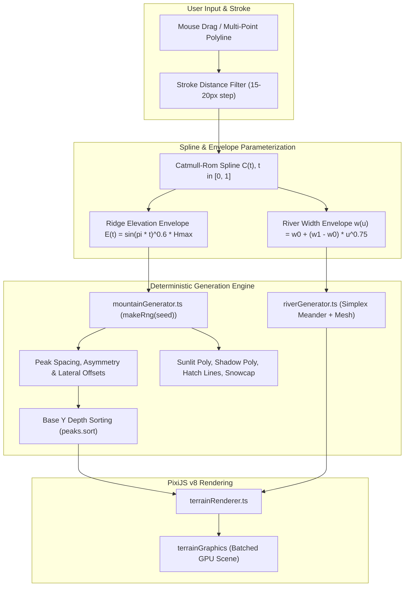

# Plan 25 — Cartographer Geographical Elements Overhaul (Procedural Mountain Ranges, Tapered Rivers, and Real-Time Drag Generation)

**Status:** proposed — awaiting implementation  
**Depends on:** Plan 21 (map-object layers), Plan 22 (material textures), Plan 23 (multi-selection), Plan 24 (place categories and terrain links)  
**Reference Map:** `docs/images/reference_faravand_map.jpg` (Hand-inked fantasy manuscript style: *FARAVAND*)

---

## 1. Problem Statement & Aesthetic Critique

The StoryForge Cartographer provides an interactive canvas for authors to craft story maps. While land sculpting, coastline echo rings, and material paper textures are in place, the rendering of inland geographical elements (mountain ranges, peaks, rivers, and forests) remains crude and geometric:

1. **Mountain Ranges are Flat Polylines**:
   - `terrainRenderer.ts` draws a `mountain_range` as a single thick stroked line (`width: 25`, color `mountainShade`) with a thin center crest. It has no peaks, no ridges, no elevation silhouette, and no woodcut texture.
   - Individual `peak` objects are rigid, identical equilateral triangles with flat fills.
   - In fantasy cartography (e.g. Tolkien, *FARAVAND*, historical illuminated manuscripts), mountain ranges consist of discrete, overlapping, hand-inked 2.5D isometric peaks with dramatic directional lighting and snowcaps.
2. **Rivers Lack Natural Hydrology**:
   - `drawRiver()` renders a uniform, constant-width polyline (`width: 3.5px`).
   - Natural rivers taper: they start as delicate springs/headwaters ($\sim 1.5 - 2\text{px}$) and broaden progressively toward the coast ($\sim 8 - 14\text{px}$).
   - They lack organic sinuosity (meanders, oxbow bends), dual-tone water wash vs. ink banks, branching tributaries, and braided delta estuaries where entering the sea.
3. **Rigid Interaction (No Drag-to-Draw for Geography)**:
   - While `land_brush` supports continuous mouse dragging to sculpt continents, `terrain_mountain` and `terrain_river` require tedious multi-clicking of discrete points followed by double-click or Enter to commit.
   - Authors cannot fluidly drag their mouse to lay down a mountain spine or river course.
4. **Uniformity (No Procedural Variation)**:
   - When generating a mountain range, peaks must not look identical. They must have relative, organic size variations (foothills at the edges, grand massifs in the core), asymmetric left/right slopes, varied ridge leans, and staggered lateral offsets.

---

## 2. Target Visual Aesthetics (The *FARAVAND* Standard)

### A. Mountain Ranges & Massifs ("HORAM PEAKS")
- **Individual Isometric 2.5D Peaks**: Sprouted along and clustered laterally around the authored ridge path.
- **Natural Elevation Envelope**: Peak height scales according to a ridge bell curve ($E(t) = \sin(\pi t)^{0.6} \cdot H_{\max}$), with foothills at the ends and soaring summits in the center.
- **Dual-Facet Directional Lighting**:
  - **West/Northwest slope (Sunlit)**: Warm parchment ivory fill (`#fffbee` / `#f9f3df`).
  - **East/Southeast slope (Shaded)**: Deep umber shadow tone (`#b8a58a`) overlaid with fine hand-inked parallel or cross-hatch lines in dark sepia ink (`#2d1f14`).
- **Dividing Crags & Peaks**: A jagged dark ink crest line descends from the apex to the base.
- **Snowcaps**: Summits exceeding the elevation snowline feature crisp ivory snowcap caps with jagged hand-inked borders.
- **Back-to-Front Depth Sorting**: Peaks are sorted strictly by their base Y-coordinate (`baseY`). Higher peaks on the screen (lower Y) render behind, while foreground peaks cleanly overlap background massifs.
- **Grounding Hatches**: Subtle ink tufts/stipples at the mountain foot ground the feature into the parchment.

### B. Rivers & Estuaries ("ZARVAN RIVER", "ARVAND RIVER")
- **Monotonic Width Tapering**: Gradually widens from headwaters ($w_0 \approx 1.5 - 2\text{px}$) to mouth ($w_1 \approx 8 - 14\text{px}$).
- **Organic Meander Spline**: Catmull-Rom spline curves perturbed by harmonic perpendicular Simplex noise to create natural sinuosity.
- **Double Inked Banks & Water Wash**: Translucent aqua-grey water ribbon (`#a5bbc6`, alpha 0.75) bounded by crisp dark ink shoreline strokes (`#2b3d4f` / `#3a2818`).
- **Delta Estuaries**: At ocean/sea outlets, the river splits into 2–3 braided distributary channels wrapping around small sandbar polygon islands.

### C. Forest Biomes ("OLD SARVESTAN")
- Rather than a uniform flat green wash, forest biomes scatter clusters of hand-inked tree crowns (rounded deciduous canopies and conifer spires) with shaded eastern flanks and back-to-front depth sorting.

---

## 3. Mathematical Models & Procedural Generation

### 3.1 Procedural Mountain Ridge Mathematics

1. **Path Smoothing**:
   Given user input points $P = [p_0, p_1, \dots, p_n]$, evaluate Catmull-Rom spline points $C(t)$ with uniform arc-length parameterization $t \in [0, 1]$ and total length $L$.
2. **Spacing & Offset**:
   Step along the spine with interval $\Delta s \approx 0.4 \times W_{\text{peak}}$.
   For each sample point at tangent $\vec{T}(t)$ and normal $\vec{N}(t) = (-\vec{T}_y, \vec{T}_x)$:
   $$\text{Offset}_{\text{lateral}} = (r_{\text{offset}} - 0.5) \cdot W_{\text{range}}$$
   $$\text{BasePosition} = C(t) + \text{Offset}_{\text{lateral}} \cdot \vec{N}(t)$$
3. **Peak Morphology**:
   For peak $i$ with deterministic pseudo-random numbers $r_0, r_1, r_2, r_3 \sim \text{Mulberry32}(\text{seed} + i)$:
   - **Height**: $H_i = E(t) \cdot (0.7 + 0.6 \cdot r_0)$
   - **Base Width**: $W_i = H_i \cdot (1.2 + 0.5 \cdot r_1)$
   - **Apex Lean (Asymmetry)**: $\Delta x_{\text{apex}} = (r_2 - 0.5) \cdot 0.35 \cdot W_i$
   - **Apex**: $A = (\text{Base}_x + \Delta x_{\text{apex}}, \text{Base}_y - H_i)$
   - **Left Foot**: $L = (\text{Base}_x - 0.55 \cdot W_i, \text{Base}_y)$
   - **Right Foot**: $R = (\text{Base}_x + 0.55 \cdot W_i, \text{Base}_y)$
   - **Center Crag Base**: $B = (\text{Base}_x + (r_3 - 0.5) \cdot 0.1 \cdot W_i, \text{Base}_y + 0.1 \cdot H_i)$
4. **Facet Polygons & Shading**:
   - **Sunlit Face**: Polygon $[L, A, B]$, filled with `landFill` parchment tone.
   - **Shadow Face**: Polygon $[A, R, B]$, filled with `mountainShade` tone.
   - **Shadow Hatching**: Parallel ink lines in $[A, R, B]$ descending at angle $50^\circ$, spaced $3-5\text{px}$.
   - **Snowcap**: For peaks with $H_i > 0.6 \cdot H_{\max}$, jagged polygon at upper 30% filled with `mountainSnowcap` (`#fffbee`).
5. **Isometric Depth Sorting**:
   All peaks are sorted by base Y:
   $$\text{peaks.sort}((a, b) \Rightarrow a.\text{baseY} - b.\text{baseY})$$
   Rendered strictly in back-to-front order.

### 3.2 Tapered Organic River Mathematics

1. **Width Interpolation**:
   $$w(u) = w_{\text{source}} + (w_{\text{mouth}} - w_{\text{source}}) \cdot u^{0.75}$$
2. **Sinuosity & Meander Perturbation**:
   $$\vec{S}_{\text{meander}}(u) = \vec{S}(u) + \left[ A_{\text{meander}} \cdot \sin(2\pi f_1 u + \phi) + \frac{A_{\text{meander}}}{3} \cdot \text{noise2D}(u \cdot f_2, 0) \right] \vec{N}(u)$$
3. **Variable-Width Mesh Generation**:
   Construct left and right bank polylines:
   $$\text{LeftBank}(u) = \vec{S}_{\text{meander}}(u) - \frac{w(u)}{2} \cdot \vec{N}(u)$$
   $$\text{RightBank}(u) = \vec{S}_{\text{meander}}(u) + \frac{w(u)}{2} \cdot \vec{N}(u)$$
   Fill the closed polygon $[\text{LeftBank}, \text{rev}(\text{RightBank})]$ with river wash, and stroke both bank boundaries with crisp dark ink lines.
4. **Delta Estuary Mouth**:
   At terminal segment ($u > 0.88$), split into 2–3 braided distributary channels flanking small sandbar islands.

---

## 4. Implementation Steps & File Structure

### File Additions & Modifications

| File | Purpose |
| --- | --- |
| `web/src/lib/engines/world/pixi/mountainGenerator.ts` *(NEW)* | Pure procedural mountain generation: peak parameterization, ridge envelopes, facet polygons, hatching, snowcaps, depth sorting. |
| `web/src/lib/engines/world/pixi/riverGenerator.ts` *(NEW)* | Pure procedural river generation: Catmull-Rom meanders, width tapering mesh, delta estuaries, bank coordinates. |
| `web/src/lib/engines/world/pixi/mountainGenerator.test.ts` *(NEW)* | Unit tests for determinism, height tapering, geometry validity, and Y-depth sorting. |
| `web/src/lib/engines/world/pixi/riverGenerator.test.ts` *(NEW)* | Unit tests for monotonic tapering, spline bounds, and non-intersecting bank boundaries. |
| `web/src/lib/engines/world/pixi/terrainRenderer.ts` | Overhaul `drawRange`, `drawPeak`, `drawRiver`, and `drawBiome` to render the rich procedural geometry. |
| `web/src/lib/engines/world/pixi/vintageTheme.ts` | Palette additions for mountain sunlit highlights, ridge crag dark ink, and river bank shading. |
| `web/src/lib/engines/world/pixi/PixiCartographerEngine.ts` | Add transient preview rendering for active drag strokes (`renderTerrainStrokePreview`). |
| `web/src/components/cartographer/PixiCartographerCanvas.tsx` | Implement continuous drag-to-draw for `terrain_mountain` and `terrain_river`, 60 FPS live preview buffering, and mouseup commit. |
| `web/src/components/cartographer/CartographerToolbar.tsx` | Add contextual controls for mountain scale (Foothills / Ridge / Alps) and river discharge (Brook / River / Amazon). |

---

## 5. Verification & Quality Invariants

1. **Determinism Invariant**:
   - Given identical feature `id` and `points`, the generated geometry must be 100% reproducible across reloads, zooms, and map exports.
2. **Performance (60 FPS Drag)**:
   - Mouse movement during continuous mountain/river drag must update local PixiJS graphics buffers without triggering React re-renders or backend sync until mouse release.
3. **No Glitch Overlaps**:
   - Peaks must never render with inverted depth (foreground peaks occluded by background peaks). Base Y depth sorting must strictly guarantee correct 2.5D visual stacking.
4. **Test Suite Integrity**:
   - All existing 1,400+ unit tests across the repository must remain green (`npm --prefix web test`).
   - Production build compiles cleanly with zero TypeScript errors (`npm --prefix web run build`).
