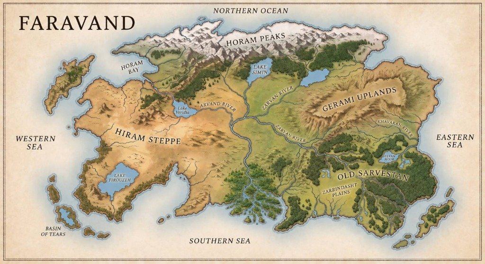
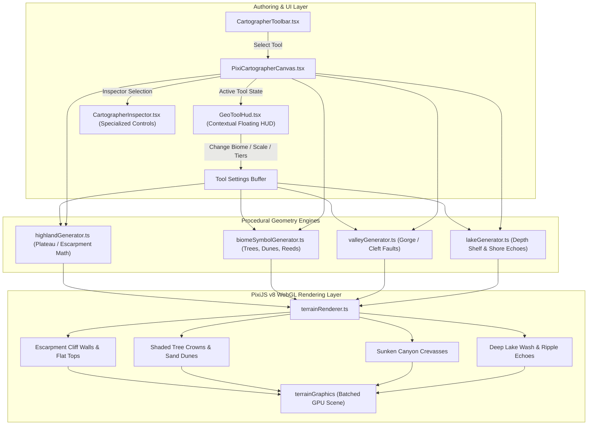

# Plan 26 — Cartographer Highlands, Lakes, Canyons & Biomes Overhaul

**Status:** proposed — awaiting user approval  
**Depends on:** Plan 21 (map-object layers), Plan 22 (material textures), Plan 23 (multi-selection), Plan 24 (place categories), Plan 25 (procedural mountains & rivers)  
**Reference Map:** `docs/images/reference_faravand_map.jpg` (Hand-inked fantasy manuscript style: *FARAVAND*)

---

## 1. Goal Description

Following the successful overhaul of procedural 2.5D mountains and tapered rivers, this plan expands the StoryForge Cartographer with:

1. **Highlands & Plateaus (`highland` / `plateau`)**:
   - A distinct geographic category for elevated, flat-topped terrain (mesas, plateaus, and tablelands) that have a higher elevation floor than surrounding land but are not pointed mountains.
   - Modeled after the **"GERAMI UPLANDS"** in the reference map *FARAVAND*: tiered escarpment cliff rims, flat elevated table surface, and shaded vertical/slanted cliff hatching along drop-off faces.
2. **Hand-Inked Lakes & Inland Waters (`lake`)**:
   - Depth-tinted watercolor washes (shallow shelf to deep indigo core), concentric wave contour echo rings, and shoreline reeds.
3. **Cleft Valleys, Gorges & Chasms (`valley` / `canyon` / `chasm`)**:
   - Sunken rift clefts with dual fault lips, interior gorge shadow tones, and vertical rock strata hatching.
4. **Procedural Biome Symbols & Textures (`forest`, `desert`, `swamp`, `tundra`, `plains`)**:
   - **Forests & Jungles ("OLD SARVESTAN")**: Hand-inked clusters of deciduous round crowns and conifer spires with shaded East flanks and back-to-front depth sorting.
   - **Deserts**: Wavy wind-swept sand dune ridges and stippled desert floor markings.
   - **Swamps**: Peat water hollows with tufted marsh reed symbols.
   - **Tundras**: Glacial crevasse rifts and frost striations.
5. **Contextual GeoToolHud & Inspector UI**:
   - An intuitive floating in-canvas tool HUD (`GeoToolHud.tsx`) that activates dynamically when any geographic tool is selected:
     - Biome palette switcher (Jungle, Ancient Forest, Dunes, Swamp, Tundra, Steppe) with density slider.
     - Highland elevation shelf & cliff tiers control.
     - Valley/Canyon depth & width control.
     - Mountain scale & snowcap toggle.
     - River width & discharge control.
   - Enhanced `CartographerInspector.tsx` with specialized controls for each terrain type.



---

## 2. Architecture & Data Flow



---

## 3. Mathematical Models & Procedural Generation

### 3.1 Highlands & Plateaus (`highlandGenerator.ts`)
In fantasy manuscript cartography (e.g. *Gerami Uplands* in *FARAVAND*), an upland is defined by an elevated flat floor terminating in an **escarpment cliff wall**:
- **Geometry Representation**:
  - Supports both **Area Plateau Polygons** (closed polygon of high tableland) and **Escarpment Ridges** (polyline cliff edge).
- **Cliff Escarpment Generation**:
  - Given an escarpment line or the southern/eastern edge of a plateau polygon (facing away from the northwest sun):
  - Sample along the edge with interval $\Delta s \approx 12 - 18\text{px}$.
  - At each step, drop a cliff face wall downward by height $H_{\text{cliff}} \approx 12 - 30\text{px}$ (modulated by deterministic noise).
  - Render:
    1. Flat top surface: elevated parchment wash (`#fbf7ea`).
    2. Upper lip: crisp dark ink stroke (`#2d1f14`) with subtle jagged fault crags.
    3. Cliff face shadow: shaded vertical/slanted hatch lines (`#8c7355` / `#2d1f14`) indicating rock strata and sheer elevation drop.
    4. Optional multi-tiered steps: secondary terrace contour shelf.

### 3.2 Procedural Biome Symbols (`biomeSymbolGenerator.ts`)
Rather than flat monotone polygon fills:
- **Forests / Jungles ("OLD SARVESTAN")**:
  - Sample points inside the polygon using Poisson disk or jittered grid with configurable density.
  - For each tree:
    - Crown radius $R \approx 7 - 14\text{px}$.
    - Deciduous tree: 3–5 overlapping rounded lobes with sunlit cream-green highlight on West and dark ink shadow hatch on East flank.
    - Conifer pine: triangular stepped spire with central ridge and shaded eastern face.
    - Palm tree: radiating frond strokes.
    - Base: tiny 2px dark ink trunk.
    - Depth sorted strictly by Y coordinate so foreground tree crowns overlap background trees.
- **Dune Deserts**:
  - Generate parallel, curving S-shaped sand dune ridge lines oriented perpendicular to prevailing winds.
  - Shaded south-east slope with soft warm umber stippling.
- **Swamps & Marshes**:
  - Stagnant water puddle polygons with 3-prong tufted marsh reed grass symbols.
- **Tundras**:
  - Jagged glacial crevasse crack lines and frost striations.

### 3.3 Sunken Valleys & Canyons (`valleyGenerator.ts`)
- Dual-rim cleft: Left rim (North/West) and Right rim (South/East).
- Sunken shadow floor between rims filled with dark umber wash (`#423224` at alpha 0.45).
- Inward-facing cliff strata hatches descending from both rims toward the central crevasse bottom.

### 3.4 Depth-Tinted Lakes (`lakeGenerator.ts`)
- Multi-tier water depth:
  - Concentric inset contour rings calculated via polygon offset buffering.
  - Outer shallows: translucent aqua wash (`#a5bbc6`, alpha 0.5).
  - Deep interior core: deep indigo-slate wash (`#5a7b91`, alpha 0.85).
  - Hand-inked coastline wave echo rings radiating outwards into the land.

---

## 4. Proposed Changes & File Additions

### Schema & Data Types
#### `[MODIFY] web/src/lib/types/world.ts`
- Extend `MapTerrainType` to include `'highland'` and `'plateau'`:
  ```ts
  export type MapTerrainType =
    | 'continent'
    | 'island'
    | 'ocean'
    | 'sea'
    | 'lake'
    | 'river'
    | 'mountain_range'
    | 'peak'
    | 'volcano'
    | 'highland'
    | 'plateau'
    | 'valley'
    | 'canyon'
    | 'chasm'
    | 'forest'
    | 'desert'
    | 'tundra'
    | 'swamp'
    | 'wasteland'
    | 'plains'
    | 'oasis'
    | 'arcane_anomaly';
  ```

---

### Procedural Geometry Engines
#### `[NEW] web/src/lib/engines/world/pixi/highlandGenerator.ts`
- Pure mathematical engine for Highlands and Plateaus:
  - Generates flat-topped tablelands, stepped escarpment cliff walls, and rock strata shadow hatching.
  - Deterministic pseudo-random seeding via `makeRng`.

#### `[NEW] web/src/lib/engines/world/pixi/biomeSymbolGenerator.ts`
- Procedural distribution and geometry for:
  - Clustered hand-inked tree crowns (deciduous, pine, palm) with depth sorting.
  - Sand dune ridges and desert ripples.
  - Marsh reeds and peat pools.

#### `[NEW] web/src/lib/engines/world/pixi/valleyGenerator.ts`
- Sunken canyon / gorge cleft geometry with inward-facing cliff strata and shadow floors.

#### `[NEW] web/src/lib/engines/world/pixi/highlandGenerator.test.ts`
- Unit tests for highland cliff geometry, non-degenerate polygons, and determinism.

#### `[NEW] web/src/lib/engines/world/pixi/biomeSymbolGenerator.test.ts`
- Unit tests for tree clustering, point-in-polygon containment, and Y-depth sorting.

---

### WebGL Rendering Pipeline
#### `[MODIFY] web/src/lib/engines/world/pixi/terrainRenderer.ts`
- Add `drawHighland()`: renders elevated table surface + stepped escarpment cliff walls.
- Overhaul `drawBiome()`: renders base wash plus procedural hand-inked symbols (trees, dunes, reeds).
- Overhaul `drawValley()`: renders sunken gorge cleft with dual-rim shadow hatching.
- Overhaul `drawWaterBody()` (lake): renders multi-tier depth gradients and shore ripple echoes.

#### `[MODIFY] web/src/lib/engines/world/pixi/vintageTheme.ts`
- Add theme palette tokens:
  - `highlandTop`: `#fbf7ea` (elevated sunlit tableland)
  - `highlandCliff`: `#8c7355` (rock strata cliff shadow)
  - `canyonFloor`: `#3d2c1e` (deep gorge shadow)
  - `lakeDeep`: `#5a7b91` (deep lake core)
  - `treeCrownHighlight`: `#d8e2c8`
  - `treeCrownShadow`: `#2f4028`

---

### Interactive UI Layer & Tool HUDs
#### `[NEW] web/src/components/cartographer/canvas/GeoToolHud.tsx`
- A floating in-canvas tool options bar (positioned at top center, mirroring `LandSculptHud`):
  - **When `terrain_highland` is active**:
    - Elevation shelf slider (Low plateau / High tableland / Mesas).
    - Cliff style toggle (Single Escarpment / Stepped Terraces).
  - **When `terrain_biome` is active**:
    - Biome switcher tabs: 🌲 Forest, 🌴 Jungle, 🏜️ Desert, 🌾 Plains, 🍄 Swamp, ❄️ Tundra.
    - Tree / Symbol density slider (Sparse / Lush / Dense canopy).
  - **When `terrain_valley` is active**:
    - Gorge depth & width slider.
  - **When `terrain_mountain` is active**:
    - Peak scale & snowcap toggle.
  - **When `terrain_river` is active**:
    - River width & discharge slider.

#### `[MODIFY] web/src/components/cartographer/CartographerToolbar.tsx`
- Add Highlands & Plateaus tool button (`terrain_highland`) with custom Mesa icon.
- Add Lake & Waters tool button (`terrain_lake`).
- Update tooltip descriptions.

#### `[MODIFY] web/src/components/cartographer/CartographerHeader.tsx`
- Update `CartographerTool` type to include `'terrain_highland'` and `'terrain_lake'`.

#### `[MODIFY] web/src/components/cartographer/CartographerInspector.tsx`
- Add specialized property panels for `highland`, `valley`, `lake`, and biomes:
  - Biome icon badge, symbol density slider, tree type selector.
  - Highland terrace count and cliff drop height.
  - Lake depth tint and contour echo rings count.

#### `[MODIFY] web/src/components/cartographer/PixiCartographerCanvas.tsx`
- Wire up `GeoToolHud` for live property adjustments during authoring.
- Add drag-to-draw support for highlands (drawing an escarpment ridge or painting a plateau).

---

## 5. Verification Plan

### Automated Tests
1. `npx tsx --test web/src/lib/engines/world/pixi/highlandGenerator.test.ts`
   - Verify deterministic generation of cliff walls and table surfaces.
2. `npx tsx --test web/src/lib/engines/world/pixi/biomeSymbolGenerator.test.ts`
   - Verify tree crown distribution, containment inside polygon, and Y-depth sorting.
3. Full test suite: `npm --prefix web test` (all 1400+ tests must remain green).
4. TypeScript compilation: `node web/node_modules/typescript/bin/tsc --project web/tsconfig.json --noEmit`.

### Manual Verification
1. **Highlands / Plateaus**:
   - Select the Highland tool, drag across canvas.
   - Confirm flat elevated table surface with shaded escarpment cliff walls descending to surrounding terrain.
2. **Biomes**:
   - Select Biome tool, choose Forest / Jungle in `GeoToolHud`.
   - Drag or click to paint a forest polygon.
   - Confirm hand-inked shaded tree crowns spawn inside the area with depth layering.
   - Switch to Desert: confirm wavy sand dune ridge lines render cleanly.
3. **Lakes & Canyons**:
   - Confirm lakes feature multi-tone depth wash and wave echoes.
   - Confirm canyons show deep gorge shadow clefts with strata hatching.
4. **Tool HUD & Inspector**:
   - Verify changing sliders in `GeoToolHud` immediately calibrates the next stroke.
   - Verify selecting existing terrain elements in the Inspector shows their specialized controls.
