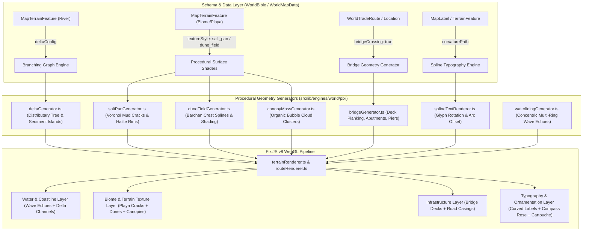
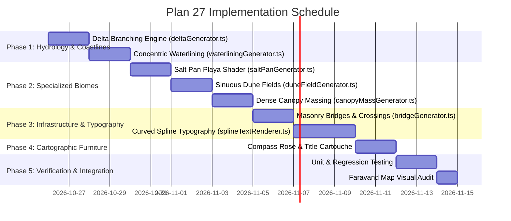

# Plan 27 — Cartographer Reference Fidelity & Natural Landforms Engine

**Status:** Proposed — Awaiting User Approval  
**Depends on:** Plan 21 (Map-Object Layers), Plan 24 (Place Categories & Terrain Links), Plan 25 (Procedural Mountains & Rivers), Plan 26 (Highlands, Lakes, Canyons & Biomes)  
**Target Reference:** `docs/images/reference_faravand_map.jpg` (Hand-inked illuminated fantasy manuscript map of *FARAVAND*)

---

## 1. Executive Summary & Fidelity Gap Analysis

While Plans 25 and 26 introduced 2.5D procedural ridgelines, single-tapered rivers, highland plateaus, and scatter biome symbols, a direct comparison between the current Cartographer canvas and the official illuminated manuscript map of **FARAVAND** reveals key missing features required to achieve true cartographic parity:

```
┌────────────────────────────────────────────────────────────────────────────────────────┐
│                                 FARAVAND REFERENCE MAP                                 │
├────────────────────────────────┬───────────────────────────┬───────────────────────────┤
│ Feature                        │ Current Cartographer State│ Reference Map Reality     │
├────────────────────────────────┼───────────────────────────┼───────────────────────────┤
│ 1. River Terminus              │ Single tapered polyline   │ Multi-branch delta fan    │
│                                │ ending abruptly at mouth  │ emptying into ocean bay   │
├────────────────────────────────┼───────────────────────────┼───────────────────────────┤
│ 2. Coastal & Shoreline Waters  │ Single inner/outer border │ Concentric wave ripples   │
│                                │ outline                   │ (parallel echo contours)  │
├────────────────────────────────┼───────────────────────────┼───────────────────────────┤
│ 3. Salt Depressions (Sepidchal)│ Generic low-elevation tint│ Cracked white-crust playa │
│                                │ or simple biome polygon   │ with salt polygon borders │
├────────────────────────────────┼───────────────────────────┼───────────────────────────┤
│ 4. Desert Dunes (Hiram Steppe) │ Generic beige ground with │ Sinuous barchan dune      │
│                                │ scattered dot symbols     │ ridges & windward ripples │
├────────────────────────────────┼───────────────────────────┼───────────────────────────┤
│ 5. Forest Massing              │ Scattered individual tree │ Continuous canopy groves  │
│                                │ icons                     │ with cloud-like outlines  │
├────────────────────────────────┼───────────────────────────┼───────────────────────────┤
│ 6. Major Regional Typography   │ Horizontal, flat text     │ Spline-aligned curved text│
│                                │ blocks only               │ following natural contours│
├────────────────────────────────┼───────────────────────────┼───────────────────────────┤
│ 7. River Bridges (Zarrin-Pol)  │ Dashed route passing over │ Explicit masonry bridge   │
│                                │ river geometry with no deck│ deck crossing waterbanks │
├────────────────────────────────┼───────────────────────────┼───────────────────────────┤
│ 8. Manuscript Furniture        │ Coordinates & simple grid │ Ornate compass rose, title│
│                                │                           │ cartouche & sea vignette  │
└────────────────────────────────┴───────────────────────────┴───────────────────────────┘
```

This plan defines the end-to-end mathematical models, data schemas, PixiJS v8 WebGL rendering pipeline, and interactive authoring tools to bridge every item in this fidelity gap.

---

## 2. Architecture & Data Flow



---

## 3. Mathematical Models & Detailed Technical Specifications

### Module 1: Hydrology V2 — River Deltas & Distributaries (`deltaGenerator.ts`)

In natural cartography, large rivers like the **Zarvan River** do not terminate as a single tapered line; upon reaching low gradient coastal plains, they split into a braided alluvial fan with distributary channels and sediment islands.

1. **Schema Extension (`MapTerrainFeature`)**:
   ```typescript
   export interface RiverDeltaConfig {
     enabled: boolean;
     apexFraction?: number; // Point along river length (0.75 - 0.95) where delta begins
     spreadAngleDegrees?: number; // Total angular fan spread (30° - 75°, default: 48°)
     distributariesCount?: number; // Number of terminal mouths (2 - 6, default: 4)
     islandRoughness?: number; // Organic fractal noise on sediment bars (0..1)
     sedimentColor?: string; // Silt/sand bank color (e.g. '#e2d4b7')
   }
   ```

2. **Delta Generation Algorithm**:
   - **Apex Detection**: Locate $P_{\text{apex}}$ at distance $L \cdot f_{\text{apex}}$ from the river mouth along the main centerline.
   - **Branching Tree (Directed Acyclic Graph)**:
     - Compute the main river tangent vector $\vec{T}_{\text{mouth}} = \frac{P_{\text{mouth}} - P_{\text{apex}}}{\|P_{\text{mouth}} - P_{\text{apex}}\|}$.
     - Spawn $N$ distributary branches radiating between $\theta_{\min} = -\frac{\alpha}{2}$ and $\theta_{\max} = +\frac{\alpha}{2}$.
     - For each branch $k \in [0, N-1]$, generate an independent Catmull-Rom spline with gentle random sinuosity ending at the sea/coastline boundary.
     - Distribute river discharge: branch width $w_k = W_{\text{main}} \cdot \left(\frac{Q_k}{\sum Q}\right)^{0.6}$, tapering smoothly to the mouth.
   - **Sediment Islands (Alluvial Bars)**:
     - Triangulate the inter-branch voids using polygon difference between adjacent branch bank curves.
     - Render sediment islands with dry silt parchment tones and subtle shoreline reed hatching.

---

### Module 2: Coastal & Shoreline Waterlining (`waterliningGenerator.ts`)

The illuminated manuscript uses concentric parallel wave contour lines hugging the mainland, islands, and large inland lakes (e.g. *Lake Veridia* and *Lake Firouzeh*).

1. **Polygon Inset/Offset Geometry**:
   - For a given land polygon or lake polygon:
   - Compute $M$ successive outward (for land) or inward (for lakes) buffer offsets at distances $d_i = d_0 + i \cdot \text{step}$ (e.g., $d \in [4\text{px}, 9\text{px}, 16\text{px}, 25\text{px}]$).
   - Use Clipper-lib / polygon expansion with arc-join rounding to maintain smooth offshore curves.
2. **Stroke Styling & Atmospheric Falloff**:
   - Ring 0 (nearest shore): Darker sepia/ocean ink (`#486b7f` at 45% opacity), stroke width `1.5px`.
   - Ring 1: Medium tone at 30% opacity, stroke width `1.0px`.
   - Ring 2: Subtle tone at 18% opacity, stroke width `0.75px`.
   - Ring 3 (furthest ocean ring): Soft dashed/stippled line at 10% opacity, fading seamlessly into the open sea.

---

### Module 3: Specialized Biome Textures

#### A. Salt Pan & Playa Crust (`saltPanGenerator.ts`) — For *Sepidchal*
Sepidchal is an arid sunken basin encrusted with crystallized salt.
- **Voronoi Halite Cell Generation**:
  - Sample Poisson seed points within the polygon boundary with average cell spacing $S_{\text{cell}} \approx 14 - 24\text{px}$.
  - Compute Voronoi tessellation clipped to the feature polygon.
  - Render cell interiors with a stark bleached chalk-white wash (`#f8fafc` / `#f1f5f9` with 70% opacity).
  - Draw mud crack borders with a crisp, slightly irregular dark brown hairline (`#5c4a38`, width `0.8px`).
  - Add crystalline stipple dots near the centers of major cells.

#### B. Sinuous Dune Fields (`duneFieldGenerator.ts`) — For *Hiram Steppe*
Hiram Steppe is a vast arid sand waste.
- **Barchan Crest Splines**:
  - Distribute crescent dune ridge splines perpendicular to the prevailing regional wind vector $\vec{W} = (\cos \theta_w, \sin \theta_w)$.
  - Crest curves follow a parabolic or soft catenary arc $y = a x^2$.
  - Windward slope: soft stippled gradient or light sunlit paper fill.
  - Leeward slip face: dark crescent shadow hatch (`#8c7355` / `#3d2e1e`) tapering off at the horns of the dune.

#### C. Continuous Forest Canopy Massing (`canopyMassGenerator.ts`)
Instead of sparse discrete icons, dense ancient woodlands (*Jangal-e Shabnam*) are depicted as continuous cloud-like foliage banks.
- **Bubble Hull Algorithm**:
  - Cluster tree seed locations into continuous contiguous groves.
  - Compute the outward envelope using overlapping circular arcs (radius $R \approx 12 - 20\text{px}$).
  - Outline the collective canopy perimeter with an ink stroke featuring scalloped leafy crests.
  - Apply an interior parchment forest wash with east-side depth shading and discrete crown highlights along the north-west sun-facing rim.

---

### Module 4: Curved & Spline-Aligned Typography (`splineTextRenderer.ts`)

In manuscript cartography, geographic titles curve along mountain ranges, rivers, and bays.

1. **Schema Support**:
   ```typescript
   export interface CurvedLabelConfig {
     pathPoints: MapPoint[]; // Baseline guide spline
     alignment: 'center' | 'left' | 'right';
     letterSpacing: number; // Extra character tracking (default: 4px)
     curvatureType: 'catmull_rom' | 'bezier';
   }
   ```
2. **Decomposition & Glyph Transformation**:
   - Discretize the guide path into fine distance-parameterized segments $s(t)$.
   - Measure individual glyph widths $w_k$ from the selected font.
   - For each character:
     - Find arc-length position $s_k$ along the curve.
     - Evaluate coordinates $(x_k, y_k)$ and tangent angle $\theta_k = \text{atan2}(dy, dx)$.
     - Render each glyph at $(x_k, y_k)$ rotated by $\theta_k$, with an optional slight perpendicular baseline offset.
   - Fall back smoothly to horizontal text when the guide path radius of curvature is too sharp to prevent glyph collisions.

---

### Module 5: Civil Infrastructure — Bridges & Crossings (`bridgeGenerator.ts`)

*Zarrin-Pol* is the central landmark of Arc 1—a strategic bridge spanning the Zarvan River.

1. **Bridge Detection & Snapping**:
   - When a trade route intersects a river or when a location has `isBridge: true`:
   - Compute the exact intersection point $P_{\text{cross}}$ and the river flow angle $\theta_{\text{river}}$.
   - Orient the bridge deck perpendicular to the water flow: $\theta_{\text{bridge}} = \theta_{\text{river}} + 90^\circ$.
2. **Bridge Graphics Rendering**:
   - **Abutments**: Stone masonry ramps anchoring the bridge onto the left and right riverbanks.
   - **Deck**: Elevated wooden or stone roadway spanning the water, clipping the river stroke beneath it.
   - **Parapets**: Parallel dark ink handrails flanking the road.
   - **Piers**: Triangular cutwaters/piers visible in the river channel casting downstream water ripples.

---

### Module 6: Manuscript Furniture & Embellishments

1. **Compass Rose (Windrose)**:
   - Procedural 16-point nautical star with alternating dark sepia and parchment highlighted facets.
   - Placed in an open ocean corner (e.g. Gulf of Marvarid).
2. **Title Cartouche**:
   - Ornate Baroque/Renaissance strapwork frame displaying the world name ("FARAVAND") with decorative leaf flourishes and subtitle ribbons.
3. **Scale Bar**:
   - Dual-unit linear scale bar displaying Imperial Parasangs (*Farsakh*) and Miles.
4. **Maritime Vignettes**:
   - Discrete hand-inked caravel ship and sea serpent sprites decorating ocean negative space.

---

## 4. UI & Authoring Studio Integration

1. **Cartographer Toolbar Extensions (`CartographerToolbar.tsx`)**:
   - New tool buttons under Geography:
     - **Delta Tool**: Click a river terminus to configure alluvial branching.
     - **Curved Text Tool**: Draw a guide line and type a spline-aligned label.
     - **Bridge Tool**: Stamp a bridge crossing over any river/chasm.
2. **Contextual HUD (`GeoToolHud.tsx`)**:
   - When the Dune tool is active: Slider for *Dune Density* and *Wind Angle*.
   - When the Salt Pan tool is active: Slider for *Crust Brightness* and *Crack Frequency*.
   - When the Delta tool is active: Controls for *Branch Count* and *Fan Spread*.
3. **Cartographer Inspector Updates (`CartographerInspector.tsx`)**:
   - Full property inspection and fine-tuning for all new terrain parameters with immediate live canvas preview.

---

## 5. Implementation Roadmap



### Phase Breakdown
* **Phase 1: Hydrology & Coastlines**: Implement `deltaGenerator.ts` and `waterliningGenerator.ts`. Connect them to `terrainRenderer.ts`.
* **Phase 2: Surface Biomes**: Implement `saltPanGenerator.ts`, `duneFieldGenerator.ts`, and `canopyMassGenerator.ts`. Update biome tool settings in Studio.
* **Phase 3: Civil Infrastructure & Typography**: Implement `bridgeGenerator.ts` and `splineTextRenderer.ts`. Enable bridge stamping at Zarrin-Pol.
* **Phase 4: Manuscript Furniture**: Add vector compass rose, title cartouche banner, and scale bar overlays to the canvas.
* **Phase 5: Testing & Visual Calibration**: Full unit test coverage across all new math modules, verify 60 FPS rendering under PixiJS v8, and visually align all Faravand landmarks.

---

## 6. Testing & Quality Invariants

1. **Mathematical Invariants**:
   - Delta distributary branches must never loop backwards ($|\theta_{\text{branch}} - \theta_{\text{main}}| < 90^\circ$).
   - Wave ripple offsets must never generate negative-area self-intersecting loops.
   - Voronoi mud cracks must clip strictly to the feature polygon boundary with zero vertex leaks.
   - Spline text glyphs must maintain monotonic distance ordering without overlapping characters on tight radii.
2. **Performance Constraints**:
   - Re-rendering all biome textures and water echoes on the 2400×1600 canvas must take under 16ms (sustaining 60 FPS pan/zoom).
   - All procedural generation must be 100% deterministic using seeded PRNG (`makeRng(seed)`).
3. **Backwards Compatibility**:
   - Existing maps without delta or curved text configurations must continue to render identically without migration errors.
